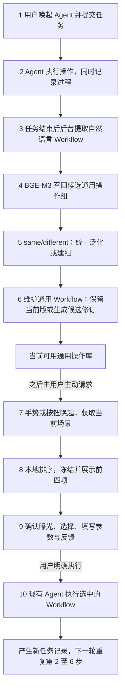

# Agent 经验、Workflow、通用操作与推荐：代码及数据全流程

**2026-10-20 停用更新：** `pipeline_policy.py` 统一关闭 Workflow 生成及后续归组、
参数提取、旧推荐和执行入口；下文描述保留的旧实现及历史数据。
迁移方案、接入验证和完整提示词见 [Computer History 推荐方案](COMPUTER_HISTORY_RECOMMENDATIONS.md)。

当前提取与归组已于 2026-10-20 更新，字段和 prompt 以 [当前操作管线](WORKFLOW_OPERATIONS.md#当前管线二分类与统一泛化2026-10-20) 为准；下文保留的旧实验说明不代表新 prompt 的限制。

2026-10-19：通用任务分类与单步回答 Workflow 已接入同一流水线。
`task_metadata.py` 定义任务/输出标签、简洁格式版本和分类契约；
`recording/task_profile.py` 从真实事件派生实际工具类型、调用状态与来源引用，
经 `records.py` 的 `.profile.json` 和页面回查，随 `workflow_evidence.py` 进入提取快照。
`workflow_prompt.py` 当前为 `agent-awm-6`：同次后台请求生成任务分类和自然语言步骤；
`workflow_contract.py` 对 tool/response 步骤分别验证真实调用/已返回答案来源。
`operation_ingest.py` 保留语义分类和实际能力来源，分类随完整 Workflow 进入召回、
通用版本及推荐；实时排序仍在本地，不新增前台模型请求。历史 v4/v5 保留并兼容。

适用版本：2026-10-18 的源码项目。实现按阶段归到同一个代码目录，保留旧命令、导入兼容入口和数据位置。10 月 18 日新增本地轨迹精简、模型输入去重及离线测量：保留原记录、动作/观察身份和完整引用，提示词解释精简及共享内容格式；没有更换模型、提取产物结构、归并规则、推荐算法、手势规则或数据库结构。

## 任务操作台与参数契约更新（2026-10-20）

记录总览新增 `workbench.html`。按时间选择任务后，可以依次重新提取 Workflow、合并或生成通用流程、针对当前通用组提取该任务的参数。原有自动后台与历史阅读入口保留。操作台的使用方式和状态含义见 [任务操作台](AGENT_RECORDING.md#任务操作台)。

| 文件 | 职责 |
| --- | --- |
| `recording/workbench_data.py` | 只读汇集任务、当前提取版本、所属组、候选、参数和操作历史，不创建业务数据库 |
| `recording/workbench_actions.py` | 持久化定向请求，消费所选任务的归组/参数步骤，拒绝过期版本，恢复中断并接入显式候选采用 |
| `recording/workbench_view.py` | 任务时间线、搜索/排序/筛选、三阶段操作区、候选来源对照、历史与实时状态 |
| `workflow_content.py` | 当前自然语言 Workflow 内容契约及旧格式投影 |
| `extraction/workflow_simple_contract.py` | 简洁提取格式与来源校验 |
| `parameters/parameter_contract.py` | 可选/必填参数统一判定、绑定与缺省说明 |
| `parameters/parameter_rules.py` | 明确字段、可信历史、文件路径和数量的规则提取；剩余参数交给 LLM |

手动请求保存在 `workflows/queue.sqlite3` 的 `workbench_actions` 表，由 `extraction/workflows.py` 现有独立 worker 处理。HTTP 请求不运行模型。候选采用复用 `operation_merge.py` 的完整组审阅与版本校验，并保留所有旧流程、归组事件和参数记录。

## 1. 先从哪里看

**实现代码统一入口：[`src/proximic_ring/agent_workflow/`](../src/proximic_ring/agent_workflow/)。**

**数据页面统一入口：[`agent-experience/overview.html`](../agent-experience/overview.html)。** 页面按顺序提供四个独立入口：Agent 任务与记录、Workflow 库、分组与通用 Workflow、推荐与执行反馈。同一目标页面只出现一次主入口；独立测试收进历史报告。各模块保留一个返回总览入口，去掉跨模块导航，原有 HTML 地址及历史记录仍保留。

Agent 任务区的“记录”按钮通过本机服务直接打开 `overview.html` 全流程总览。Workflow 库和审计页展示来源任务的前台 App、采集时间与能否参与场景统计；通用组展示各前台 App 的真实任务次数和未知次数，组内每条成员也展示自己的来源应用。测试来源单列，不混入真实频率；应用名称来自来源元数据，不从流程目标猜测。

应用使用方法不变：启动 Downloads 源码应用 → Agent「记录」→「全流程总览」；需要执行推荐时使用 Agent「推荐」或已配置的手势，默认 `double-index-pinch`。HTML 总览负责回查，不会因为打开页面而执行任务、请求模型或产生推荐曝光。

只重新生成总览，不调用任何模型：

```sh
cd /Users/admin/Downloads/ProximicVoice-main
PYTHONPATH=src .runtime/venv/bin/python -m proximic_ring.agent_workflow.reporting.overview \
  --root ./agent-experience
open ./agent-experience/overview.html
```

本说明以下用 **R** 表示同一次应用运行使用的记录根目录：

- Downloads 源码的默认 R：`/Users/admin/Downloads/ProximicVoice-main/agent-experience`。
- 当前 worktree 源码有它自己的 `agent-experience`，与 Downloads 不共享数据库。
- 安装版默认 R：`~/Library/Application Support/ProxiMic Voice/agent-experience`。
- 显式 `--root`、应用当前 `recordsRoot` 或 `PROXIMIC_DATA_HOME` 会改变位置。总览页顶部始终显示其实际 R，避免把不同目录的数据混在一起。
- 真实音乐链路测试是独立根目录：`R/recommendation-tests/20261016-live-1/agent-experience`，不会计入正式用户使用统计。

### 阅读页面的组织（2026-10-18）

| 入口 | 打开后先看什么 | 详细内容 |
|---|---|---|
| Agent 任务与记录 | 任务数量、结束/进行中/异常数量、任务列表 | 单个任务的工具调用、结果与原始事件；会话列表收起 |
| Workflow 库 | 当前流程数、来源任务数、最新处理中/失败数；名称、目标概括、步骤/参数数 | 在本页展开完整步骤、条件和异常分支；来源审计与旧版导出收起 |
| 分组与通用 Workflow | 组数、成员数、版本数；组目标、成员规模和推荐统计分数 | 在本页展开当前通用流程、组内成员和候选/历史；完整流程不默认展开 |
| 推荐与执行反馈 | 请求数、实际曝光数、反馈数 | 在本页展开每次推荐的场景、排序、分数、反馈和执行状态；不重新计算历史排序 |

全局导航只保留返回总览；模块内的来源文件保留在折叠区供追溯。旧任务/分组/审计详情地址保留以兼容已有书签。页面精简不影响自动提取、重试、刷新、归并、推荐及原生执行；不会为展示概括新增模型调用。

## 2. 总体流程

**起点始终是用户调用 Agent 执行任务。** 逻辑流程仍按下面的 1–10 步解释，HTML 将相同目标页面合并为四个模块（1–2、3、4–6、7–10）；第 6 步使用统一泛化，不再单独判断 novelty。第 1–6 步积累经验，第 7–10 步在用户之后主动唤起推荐时发生，不会因为归并结束就自动弹出推荐。

| 顺序 | 功能与输入输出 | 主要代码目录 |
|---|---|---|
| 1 | 用户唤起并提交任务，记录当时的应用、时间和任务来源 | `ui/agent_controller.py`、`agent/flow.py`、`recommendation/recommendation_context.py` |
| 2 | Agent 通过 Computer Use 执行，同时异步记录事件、工具调用及实际返回内容；结束时记录状态 | `agent/` → `recording/` |
| 3 | 已结束任务进入后台队列，LLM 根据记录提取自然语言 Workflow，保留内部 JSON 和证据 | `ui/workflow_service.py` → `extraction/` |
| 4 | BGE-M3 将新 Workflow 的目标和步骤与组的通用 Workflow 比较，召回少量候选组 | `operations/operation_embeddings.py`、`operation_retrieval.py` |
| 5 | LLM 判断 same/different；same 进入统一泛化，其余建立新组 | `operations/operation_admission.py`、`operation_prototypes.py` |
| 6 | 新组建立首版；same 综合全部相关来源，原样返回则归组，修改则保存候选并审阅后启用 | `operation_synthesis.py` → `operation_update.py` → `operation_merge.py` |
| 7 | 用户之后用手势或按钮请求推荐，显示面板前重新获取当前应用和时间 | `ui/recommendation_controller.py` |
| 8 | 本地场景统计排序当前可用通用操作，冻结前四项和版本，保存推荐快照 | `recommendation/recommendation_service.py`、`recommendation_statistics.py` |
| 9 | 确认实际可见曝光，用户选择操作、填写参数或拒绝，分别保存反馈和执行票据 | `ui/recommendation_focus.py` | Hub 独立焦点、输入法辅助窗口归属与点击外部收起处理 |
| `ui/recommendation_dialog.py`、`recommendation/recommendation_feedback.py`、`execution/recommendation_execution.py` |
| 10 | 原生面板把填好参数的自然语言 Workflow 送给现有 Agent 执行，产生新任务记录 | `execution/recommendation_agent.py` → `agent/flow.py` |

第 10 步产生下一轮经验，之后重复第 2–6 步。图中把这次执行放在末尾，不用回指箭头改变主流程的视觉顺序。用户可以随时从已有操作库请求推荐，不必等所有待提取或待入组任务完成。



第 6 步内部：same 都调用统一泛化；返回当前内容时归组，修改时保存候选，无法融合时记录冲突。候选审阅并显式启用后才改变当前版。各逻辑步骤统一归到 HTML 的四个模块，在模块内查看；独立 Trials 放在测试报告区域，不作为生产主流程的必经步骤。

这里有三种不同的“学习”，不能混为一个过程：

1. **提取经验**：LLM 根据一次任务的已记录证据撰写可复用步骤。
2. **归并操作**：BGE-M3 找相似组，LLM 判断是否同类；same 统一泛化，模型可保留或改进当前流程。
3. **推荐选择**：本地统计当前场景下常用的完整操作。本版不用 LLM 排序，不使用行为序列，不训练 LinUCB；接受／拒绝反馈只记录。

## 3. 目录职责

```text
src/proximic_ring/agent_workflow/
├── agent/             原有 Agent 会话、RPC、电脑控制与任务状态
├── recording/         原始记录、可追溯步骤视图、记录 HTTP 服务
├── extraction/        后台调度、提取提示词、模型调用、Workflow 产物
├── operations/        稳定操作 ID、语义召回、入组、版本、分组页面
├── recommendation/    场景整理、统计排序、请求快照、曝光和反馈
├── execution/         推荐执行票据、送入 Agent、两组 Trials
├── ui/                Agent 界面、推荐面板、后台进程桥
│   └── qml/           Agent 卡片和动作图标
└── reporting/         全流程 HTML 入口和历史推荐阅读页
```

各目录 `__init__.py` 只说明包职责，不启动进程、模型或 UI。导入推荐代码不会加载 Torch / Sentence Transformers。

共享的系统能力仍位于原模块：戒指 BLE/固件解析、全局手势配置、语音输入、macOS 可访问性通道、文本模型设置等也被其他功能使用，不把它们整体搬进 Workflow 目录。第 12 节列出接线位置；Workflow 专用执行及界面实现只有一份。

## 4. 每一步到底保存在哪里

### 4.1 原始任务与步骤

| 数据 | 实际位置 | 写入者 / 阅读者 |
|---|---|---|
| 会话元数据、记录质量 | `R/sessions/<session_id>/session.json` | `recording/recording.py` 写，`records.py` 读 |
| 全量可获得事件 | `R/sessions/<session_id>/events.jsonl` | `ExperienceRecorder` 的独立写入线程 |
| 任务、消息、调用与观察索引 | 同目录 `index.sqlite3`；主要表 `episodes`、`items`、`events`、`observations` | `ExperienceRecorder` 投影、索引 |
| 工具已经返回的图片等附件 | 同目录 `attachments/` | 记录器提取附件；不额外主动截图 |
| 一次任务的阅读页 | 同目录 `episode-<episode_id>.html` | `records.export_html()` |
| 该任务的可追溯步骤 JSON | 同目录 `episode-<episode_id>.steps.json` | `step_view.build_step_view()`，由导出器保存 |
| 会话启动等未归属任务的事件 | 同目录 `session.html` | `records.export_html()` |
| 全部任务列表 | `R/index.html` | `records.export_html()` |

Session 是运行连接层的记录单位；Episode 是一个用户任务。一次任务包含多个 RPC 消息、文字增量及工具生命周期事件，所以事件数不等于任务数。只保存接口实际提供的推理摘要，不获取或补写隐藏思维链。

步骤关联按任务/线程/轮次/调用标识建立。没有明确观察就标记缺失，不把相邻调用返回强行绑定为动作前后状态。每个步骤保留原始事件引用，能回到 `events.jsonl` 或 HTML 的事件锚点。

### 4.2 Workflow 提取

| 数据 | 实际位置 | 含义 |
|---|---|---|
| 提取队列 | `R/workflows/queue.sqlite3`；`jobs`、`meta`、`job_retries` | 排队、运行、成功、失败、来源任务、提取版本及最多 3 次自动重试链 |
| 去重前证据快照 | `R/workflows/<job_id>.input.json` | 来源任务、证据索引及完整事件引用；旧版本也是实际模型输入 |
| 精简轨迹 | `R/workflows/<job_id>.trajectory.json` | 本地筛选后的证据，所有动作/观察不变；常规自动许可事件以摘要及原 E 编号列表保留 |
| 精简审计清单 | `R/workflows/<job_id>.trajectory-selection.json` | 每处省略的规则、证据 ID、原始事件引用；文档的内容路径、长度与 SHA-256 |
| 实际模型输入 | `R/workflows/<job_id>.model-input.json` | 精简轨迹再去重，共享正文只存一份，保留调用/步骤身份和事件序号范围；新提取使用此内容 |
| 去重统计 | `R/workflows/<job_id>.compaction.json` | 前后字符数、减少比例、共享内容数；不等同于 token 或模型费用 |
| 只读去重测量报告 | `R/workflow-dedup/report.html`、`report.json` | 手动运行 `reporting/dedup_benchmark.py` 生成；不入队、不调用模型、不修改业务数据 |
| 只读轨迹精简报告 | `R/workflow-trajectory/report.html`、`report.json` | 比较原始/仅去重/轨迹精简加去重；验证真实入口和临时目录入队，不修改正式队列 |
| 提取审计 | `R/workflows/<job_id>.audit.json` / `.audit.html` | 引用、模型版本/耗时、校验状态、本次结果与局限 |
| 简洁内部结构 | `R/workflows/<job_id>.flow.json` | 名称、目标、参数、步骤、条件、异常分支 |
| 可阅读/复用自然语言 | `R/workflows/<job_id>.flow.txt` | 模型撰写的步骤按固定格式排版 |
| 不通过校验的响应 | `R/workflows/<job_id>.rejected.json` | 保留最终文本或 JSON；不混入成功草稿库 |
| 当前成功流程索引 | `R/workflows/library.json` | 每个原任务最近一次成功提取 |
| 流程库页面 | `R/workflows/library.html`；`index.html` 是兼容入口 | 看自然语言步骤，再点开来源审计 |
| 后台状态 | `R/workflows/status.json` | 队列、错误、运行状态 |

“自然语言 Workflow”指步骤正文由 LLM 撰写；模型传输/内部校验仍使用结构化 JSON。`workflow_artifacts.py` 把自然语言字段和结构投影到 `.flow.json`、排版成 `.flow.txt`，**不会再调用一个模型重新解释步骤**。审计里的 E 编号只用于来源回查，不作为最终执行步骤正文。

### 4.3 分组与通用 Workflow

| 数据 | 实际位置 / 表 | 含义 |
|---|---|---|
| 操作库主数据库 | `R/operations/catalog.sqlite3` | 分组、版本、来源、推荐及反馈持久化 |
| 一次经验及历史版本 | `samples`、`versions`、`sample_versions` | 自然语言字段的结构化表示、任务来源、场景、user/test 范围 |
| 稳定操作身份与当前版 | `operations`、`operation_heads` | operation ID 稳定；active revision 指向当前推荐用的流程 |
| 通用 Workflow 历史 | `operation_revisions` | seed、active、candidate、historical 及生成依据 |
| 组内成员与历史变化 | `operation_memberships`、`operation_membership_events` | 原经验属于哪个组，基于哪个通用版本接纳 |
| 入组/更新任务 | `operation_admissions`、`operation_updates`、`operation_jobs` | 候选召回、同类判定、新增信息、失败/不确定原因 |
| LLM 入组/修订输入输出 | `R/operations/<job_id>.operation-input.json` / `.operation-result.json` | 能还原本次模型比较了什么 |
| 当前与历史通用步骤导出 | `R/operations/definitions/<operation_id>/<revision_id>.txt` / `.json` | 自然语言通用步骤和版本/来源元数据 |
| 向量缓存 | `R/operations/embeddings.sqlite3` | 按模型、文本版本、文本内容缓存归一化向量 |
| 向量运行状态/指标 | `R/operations/embedding-status.json`、`embedding-last-compute.json` | 命中情况、计算耗时和内存等 |
| 分组总览/详情 | `R/operations/index.html`、`group-<operation_id>.html` | 组数、通用 Workflow、每条成员经验、候选和历史版 |
| 操作库导出与调度状态 | `R/operations/catalog.json`、`status.json` | 可阅读快照、警告和失败说明 |

旧 `pairs`、`assignments`、`review_jobs` 等表仍保留用于历史回查。当前主流程比较的是新 Workflow 和组的通用 Workflow，**不会运行旧 complete-linkage 或对组内所有成员逐对复核**。

### 4.4 场景、推荐列表、反馈和执行

以下表均在同一个 `R/operations/catalog.sqlite3`，不是新建一套独立的推荐业务数据库。

| 表 / 文件 | 保存内容 |
|---|---|
| `recommendation_invocations` | 唤起 ID、时间、当时前台应用、缺失标记和触发来源 |
| `recommendation_requests` | 不可变请求快照：范围、入口、全部候选摘要、前四项、排名、分数依据、场景、特征 schema、流程版本 |
| `recommendation_exposures` | 实际确认可见的候选、位置、版本、时间和曝光方法；请求生成本身不是曝光 |
| `recommendation_feedback` | 每次曝光的接受/拒绝/暂不判断，以及独立的明确成功/失败反馈 |
| `recommendation_executions` | 最终填写参数、实际发送的提示词、冻结版本、执行状态、后续 session/episode ID、错误 |
| `R/recommendations/index.html` | **新增只读视图**：最近50次已保存请求的原始排序、场景、反馈及执行回查链接 |
| `R/recommendations/<request_id>.json` | **派生导出**：该请求快照及对应曝光、反馈、执行信息；可删除后从数据库重新生成 |
| `R/overview.html`、`overview.json` | **派生导出**：整条链路的入口、计数、数据根目录、历史报告导航 |

历史推荐页展示的是请求当时的结果，不会重算成“现在的排序”。原生面板打开/刷新才会采集当前场景并请求排序；HTML 的交互推荐入口沿用 `operations/index.html`。直接打开离线 HTML 只能查看已有数据。数据库保留全部请求，总览阅读页限制最近50次以免页面无限增长，已导出的历史请求文件不会被删除。

### 4.5 执行对比和独立测试

| 数据 | 位置 |
|---|---|
| 可编辑固定任务 | `experiments/workflow_trials/tasks/<task>/task.json` 及自然语言步骤文件 |
| 不可变测试任务快照 | `R/workflow-tests/<case_id>.case.json`、`.workflow.txt` |
| 每次实际运行 | `R/workflow-tests/<run_id>.run.json`、`.prompt.txt` |
| 历史/两组对比 HTML | `R/workflow-tests/comparison.html`、`report*.html` |
| 历史归并测试数据集 | `experiments/workflow_recommendations/dataset/` |
| 完整软件链路实测 | `R/recommendation-tests/<run>/result.json`、`recommendations.png`、内层 `agent-experience/` |

当前 Trials 只生成 baseline 和自然语言 steps 两组；历史 JSON 测试只读保留。总览集中列出已有测试报告，不搬动这些数据，也不会自动重新执行测试。

## 5. `agent/`：现有 Agent 执行能力

| 文件 | 主要职责与连接 |
|---|---|
| `flow.py` | `Flow` 负责命令、线程/turn、工具请求、取消和任务完成；连接 RPC、记录器、Trials、推荐执行入口 |
| `rpc.py` | 与 Codex 进程交换 RPC，保留发送/接收回调给记录器 |
| `connection.py` | 检查登录及 Computer Use 工具可用性；检查连接本身不提交用户任务 |
| `computer_control.py` | turn 结束/取消时释放电脑控制，保持原有清理路径 |
| `interaction.py` | Agent 交互状态和手势选择转换，不承担推荐评分 |
| `requests_ui.py` | 将权限、追问、工具选择等请求整理为 UI 卡片与可用选项 |
| `choice_text.py` | 将用户文字/数字回答匹配到明确选项 |
| `workspace.py` | Agent 工作区状态、卡片与窗口排列计算 |
| `agent_focus.py` | 记住唤起前应用/窗口元数据及恢复焦点目标 |
| `attachments.py` | 校验本地附件，构造实际发送给 Agent 的输入 |

## 6. `recording/`：执行经验与可回查步骤

| 文件 | 主要职责与连接 |
|---|---|
| `recording.py` | `ExperienceRecorder` 创建 session/episode；异步记录 RPC、本地控制、已返回附件，更新 SQLite 索引并标记丢失/写入错误 |
| `records.py` | 只读加载会话，按 Episode 导出步骤、消息、事件和原始来源链接；生成原始任务 HTML 后刷新总览 |
| `step_view.py` | `build_step_view()` 按调用标识关联行动说明、工具参数、返回值和明确观察；缺失/并发/不确定均保留标记 |
| `record_controls.py` | 原始记录及 Workflow 页共享的导航、提取、重试和刷新控件；新增总览链接 |
| `records_server.py` | 带随机访问前缀的本机 HTTP 服务；原有操作只入队，模型在后台运行；总览/历史推荐 GET 只刷新派生阅读页，不注入交互轮询脚本 |

## 7. `extraction/`：从记录到自然语言 Workflow

| 文件 | 主要职责与连接 |
|---|---|
| `workflows.py` | `scan()` 找已结束任务；`source_packet()` 读取来源；`process_one()` 处理一个提取任务；`serve()` 管理空闲调度和后续入组 |
| `workflow_store.py` | 持久化提取任务、状态、来源指纹和激活时间；原子写 JSON/文本；恢复中断队列 |
| `workflow_retry.py` | 提取重试上限（额外 3 次）、10/30/60 秒退避、临时模型错误类型及状态文案；重试链保留每次来源与拒绝结果 |
| `workflow_evidence.py` | 整理有编号且可定位的证据；校验模型步骤、参数和来源引用，拒绝捏造引用 |
| `workflow_trajectory.py` | 本地规则生成提取专用轨迹；只省略已核验文档、汇总明确配对的自动许可，保留所有动作/观察和省略来源 |
| `workflow_trace.py` | v2 按序投影调用与返回，同次结果和观察只存一份正文；去掉非操作消息、空布局和已知能力装饰；来源映射独立保存 |
| `workflow_payloads.py` | 省略已知 SVG 读取结果的图片源码，保留命令、状态、原截断标记及外围错误；未知格式原样保留 |
| `workflow_contract.py` | 校验 v5 简洁输出、参数和可见来源；关键节点检查可选，最终判断必需；不宣称语义已验证 |
| `workflow_normalization.py` | 仅把模型误放在单条流程内的 extraction_notes 无损移回外层；保存原始模型 JSON 与移动路径，不改步骤或增加模型调用 |
| `workflow_compaction.py` | 在模型输入中投影重复来源元数据、共享完全相同的大段内容；保留独立证据身份；提供还原与去重后长度校验 |
| `workflow_input.py` | 统一串联 `select_trajectory → project_trace → compact_packet`，返回轨迹、精简清单、实际模型输入和统计；入口、存储和 HTTP 适配器共用 |
| `workflow_prompt.py` | 提取提示词及版本，规定完整任务、可执行细节、参数化、缺失观察等要求；解释共享内容引用，产物契约不变 |
| `workflow_model.py` | 复用现有文本服务并请求 thinking enabled；只取最终输出，保存耗时/模型元数据，不保存隐藏推理内容 |
| `workflow_limits.py` | 提取与归组/修订共用 480,000 字符本地输入上限；按实际发送文本计数，不改变服务端 token 上限或输出长度 |
| `workflow_artifacts.py` | 将合格结果分为简洁结构、自然语言步骤和来源审计；同任务重提取只选最近一次成功版本 |
| `workflow_text.py` | 保留既有确定性文本排版辅助函数，不进行新推理 |
| `workflow_view.py` | 生成简洁 Workflow 库、原始引用审计、提取历史和失败提示，再刷新总览 |

典型调用：`WorkflowService → workflows.serve → scan → prepare_evidence（build_evidence → prepare_model_input → 长度校验）→ WorkflowStore.enqueue → process_one → workflow_model.extract → validate_workflows → save_flow → export_workflows`。提取或校验失败时，以同一证据快照生成延迟重试作业；成功后自动接入后续导入、归组、文案和参数整理。

`prepare_model_input` 依次调用 `workflow_trajectory.select_trajectory`、`workflow_trace.project_trace`、`workflow_compaction.compact_packet`。第一层保留 v1 的两类规则：

- CUA 通用文档：仅来自 `cua_repl.js` 的独立 MCP 文本块，且整段 SHA-256 命中人工核验的文档版本时省略。不是按标题/关键词模糊删除；文档中附带错误、界面状态、新版本或未知字段会保留整段。文档摘要、哈希及原路径记录在精简清单。
- 常规自动许可：相同类型的 requestId、协议方法和应用标识，唯一且按序的 `automatic_approval → request_decision` 对，明确标注“自动允许（开关已开启）”，且字段形状符合已知记录版本，才按应用汇总。保留请求数、工具分布、每条原 E 编号和事件范围。拒绝、人工决定、重复/歧义 ID、未配对事件、用户澄清、取消、错误均原样保留。许可汇总不是成功证据。

v2 将实际调用和结果按序排列。同次结果与明确观察正文严格一致时合并展示，保留两者来源 ID；去掉推理摘要、计划和进度播报，保留用户输入、更正及明确的最终回复（标为未核验结论）。保留全部调用和关键参数、错误及未知内容。AX 只删空布局和已知 Secondary Actions 装饰，保留语义名称、数值、焦点及数字操作目标，不猜测页面相关性。符合已知规则的 SVG 读取结果省略源码，不解读像素。每项省略的行号、路径和原始来源记录在精简清单的 trace 区。完整记录及旧证据快照不改写。

去重完全在后台、由本地规则完成。仅内容严格相等且紧凑 JSON 长度至少 256 字符时共享，保留每次调用/观察自己的 E 编号、step_id 和 call_id。`shared_content` 内是原内容，`$content_ref` 指向它；同名原始字段通过 `$literal_content` 转义。完整事件引用留在 `.input.json`，模型通过 E 编号引用，序号范围不代表范围内所有事件都属于该条记录。没有近似合并、摘要、额外截断或额外模型调用；原有单条 40,000 字符头尾截断仍保留并明确标记。总长 240,000 字符上限改为检查实际去重后的用户输入 JSON；仍超限则提示前后长度与减少比例，不调用模型。本版尚未实现分段。

队列保存证据快照、第一层轨迹、精简清单、实际模型输入和统计五份文件；模型适配器共用 `prepare_model_input`。新提取契约为 `desktop-awm-5`，只生成具体自然语言 instruction、可选关键 check、一个最终 completion、必要参数/条件/恢复和简短 sources。完整来源映射留在本地，不再要求模型每步生成观察摘要或重复完成条件。v4 历史仍可读、可导入；v4 待处理任务需重新提取，避免混用契约。第一层规则 `local-trajectory-v1`、投影 `task-trace-v2`、精确去重 `deduplicated-evidence-v1` 各自编号，提示词保存 SHA-256。

## 8. `operations/`：完整 Workflow 归并为通用操作

| 文件 | 主要职责与连接 |
|---|---|
| `operation_ingest.py` | 导入最新合格 Workflow 及数据集，保留真实/测试来源、任务时间和唤起场景 |
| `operation_identity.py` | 内容 hash、文本归一、应用标签及冲突判断；不负责语义同类判定 |
| `operation_store.py` | 操作库连接、经验版本保存、稳定 ID/别名与历史表兼容 |
| `operation_flow.py` | 导入与候选修订共用的完整流程结构校验；兼容旧版 action/method/check 与新版 action、可选 check、最终 completion；不改写内容哈希或来源引用 |
| `operation_schema.py` | 通用版本、成员、入组、更新与独立展示文案表的建表定义 |
| `operation_prototypes.py` | 读取当前通用定义、建立种子组、附加成员、保存不可变修订、核验后启用版本、显式重查 |
| `operation_catalog.py` | 当前增量归并入口：同步经验、准备入组、依次处理 admission/update/display |
| `operation_service.py` | 后台集成层，协调同步、复核和导出状态；不在 Agent 对话发送链路执行模型 |
| `operation_embeddings.py` | 目标/步骤文本组织、BGE 缓存、空闲检测、进程锁、低资源子进程调用与中断；主应用不加载模型 |
| `operation_embedding_worker.py` | 独立 Sentence Transformers / BGE-M3 推理和模型下载入口，输出向量及耗时/内存指标 |
| `operation_generalization_prompt.py`、`operation_generalization.py` | 生成有限泛化候选并核验来源覆盖、参数去向；候选不自动改变当前操作 |
| `operation_merge.py` | 显式审阅后合并完整操作，校验版本和成员范围后在单个事务中更新归属、别名及启用定义 |
| `operation_retrieval.py` | 对各组当前通用 Workflow 做两通道余弦打分，筛出至多三个候选组 |
| `operation_admission.py` | 候选组复核、参数映射、唯一同类入组；冲突/不确定不强行归组；无匹配时建立新组 |
| `operation_admission_prompt.py` | 新经验与通用操作的同类判定及新增信息提示词 |
| `operation_novelty.py` | 校验新增信息类别、原文字段定位、逐字引用和重复内容；决定能否排入更新队列 |
| `operation_update.py` | 根据当前通用版本、实质新增信息和最多三个来源生成候选修订，不改当前 active 指针 |
| `operation_update_prompt.py` | 通用流程修订提示词：约束目标/参数契约、来源依据以及 candidate/no_change/variant_only |
| `operation_revision_validation.py` | 校验候选流程的结构、参数和变动字段引用，拒绝无来源扩张 |
| `operation_jobs.py` | 入组/修订请求去重、输入输出归档、恢复与错误记录 |
| `operation_model.py` | 后台模型调用公共适配层，复用文本服务、忙碌检查和思考设置 |
| `operation_display_prompt.py` | 共用简洁文案规则；入组建组和修订复用，历史补齐单独调用 |
| `operation_display.py` | 校验标题长度与参数名完整对应；按通用版本保存独立文案，读取和旧版回退；文案失败不阻断有效流程 |
| `operation_display_jobs.py` | 空闲时补齐缺失文案，不读原始会话、不执行电脑；失败不自动重试 |
| `operation_library.py` | 将当前组、当前成员、通用定义和历史版本组合成展示/推荐可读数据 |
| `operation_view.py` | 分组首页、静态分数、历史审计、数据集及交互推荐控件；同步更新总览 |
| `operation_group_view.py` | 每个组的独立阅读页，展示通用 Workflow、组内每条经验及来源 |
| `operation_revision_view.py` | 导出各通用版本 `.txt/.json`，展示候选、历史、入组和修订依据 |
| `operation_dataset.py` | 从历史 Trials 整理独立测试数据集及来源，不转换为真实用户习惯 |
| `operation_cli.py` | 原有 sync/review/report/serve/activate/recheck 等命令入口 |
| `operation_matching.py` | 历史逐对候选和 complete-linkage 算法，供旧测试/回查；不参与现行入组 |
| `operation_legacy.py` | 保留历史逐对复核与分组流程，支持旧数据和回归 |

模型输入边界：`workflow_model.extract()` 仅处理原始任务轨迹，会做选择、投影和去重；`operation_model.call()` 使用 `workflow_model.request_json()`，完整传入已精简的 Workflow、候选组、参数映射和来源，不再次经过轨迹精简。生成元数据中的 `input_sha256` 对应实际发送的用户输入，入组/修订可与保存的 `.operation-input.json` 按相同 JSON 编码核对。新版核验新增信息允许精确引用 `/completion`，并保留原有 `/steps/N/check`。仅格式变化不视为实质新增，不自动替换已有通用版本。

推荐状态中的 `failed` 只计当前来源版本最新入组决定、当前通用版本修订尚未解决的失败；成功重试后归零。历史付费失败请求不删除，单列 `historical_failed` 供审计，避免修复后面板仍显示永久失败。

### 8.1 召回分数及入组

每个完整 Workflow 分别编码两个归一化向量：目标文本（名称＋目标＋参数含义）和步骤文本（动作＋执行方法＋核验＋条件）。

```text
s = 0.75 × cos(新目标, 组目标) + 0.25 × cos(新步骤, 组步骤)
目标余弦 ≥ 0.50，综合分 ≥ 0.55，应用不冲突 → 最多 Top 3
```

分数只用于召回，不代表 SAME。LLM 复核只比较这几个通用定义；唯一明确 same 才加入，歧义保留。完全相同的不可变 Workflow 版本已有入组依据时，可以复用该依据，无需再次语义复核。阈值、模型和缓存键本次均不变。

### 8.2 什么是实质新增

条件、异常分支、执行路径或核验方法的新信息才可能更新。仅改写措辞、换标题/正文、重命名参数、再次成功不构成实质新增。模型提出的新增内容还需通过 `operation_novelty.py` 的原文定位和去重校验。候选修订由 `operation_revision_validation.py` 再次校验；默认保留为 candidate，验证通过并显式启用后才用于后续推荐。

## 9. `recommendation/`：场景统计推荐

| 文件 | 主要职责与连接 |
|---|---|
| `recommendation_context.py` | 场景 ID、时间、前台应用规范化、过期/缺失检查、场景持久化 |
| `recommendation_statistics.py` | 同任务去重、30天半衰期、总体先验及场景逐层平滑，输出分数和依据 |
| `operation_recommendations.py` | 遍历当前可用组，按范围计分、稳定排序、返回候选及版本/参数 |
| `recommendation_features.py` | 冻结特征 schema 和特征值，为未来 LinUCB 留接口；本版不训练 |
| `recommendation_service.py` | 主动请求的统一入口，默认前四项，保存不可变快照；HTML 选择返回冻结版本 |
| `recommendation_feedback.py` | 校验真实曝光、幂等偏好/结果反馈，导出未来在线学习所需样本 |
| `recommendation_catalog.py` | 用当前成员及 active 版本计算变化标识，读取后台队列状态；候选修订/反馈不触发改分 |
| `recommendation_view.py` | 分数卡片与依据、HTML 交互获取推荐及500ms可见曝光确认 |

本地统计从总体使用频率开始，按当时已知维度逐层收窄：前台应用 → 四小时时段 → 工作日/周末。设衰减后的组质量为 `N_g`，组数 `G`：

```text
P0(g) = (N_g + 0.5) / (Σ N + 0.5 × G)
Pnext(g) = (当前层匹配到该组的质量 + 3 × Pprevious(g)) / (该层全部匹配质量 + 3)
任务权重 = 2 ^ (-距今天数 / 30)
```

缺失维度跳过，没有匹配时回退上层。同一个任务对所有组总计一份使用质量；多次提取不会反复计数。这里没有最近操作序列概率，也没有反馈加权。这个分数是初始统计估计，不是已校准的用户意图概率。

## 10. `execution/`：把选中的流程交给原有 Agent

| 文件 | 主要职责与连接 |
|---|---|
| `recommendation_execution.py` | 从曝光读取冻结请求，校验参数，一次占位符替换；保存 accepted 和执行票据，同一曝光最多派发一次 |
| `recommendation_agent.py` | 校验票据和 Agent 空闲状态，创建有来源的新 Episode，通过现有 `Flow.start_task()` 执行并记录结束状态 |
| `workflow_trials.py` | 两组任务快照、提示词、运行耗时/工具调用和目标验证、对比报告；历史 JSON 组只读 |
| `workflow_task_files.py` | 加载可编辑任务文件，冻结任务/参数/自然语言步骤版本 |
| `workflow_trial_cli.py` | 项目终端的 list/preview/run/report 等命令，复用既有 Agent 协议和取消能力 |
| `operation_trial_bridge.py` | 将指定通用候选版本准备为可验证的 Trials 快照，连接版本验证与启用 |

推荐执行状态与反馈分开。`completed` 表示收到 Agent 轮次结束，不自动等同目标成功，不自动记录成功奖励，也不自动启用候选版本。连接不明时不自动重发，避免重复写笔记或重复发送。

## 11. `ui/` 和 `reporting/`：交互及查看

| 文件 | 主要职责与连接 |
|---|---|
| `ui/agent_setup.py`、`operations/embedding_install.py` | 新电脑准备状态、召回模型下载/取消/续传/本地导入及固定哈希校验，见 [安装准备](AGENT_SETUP.md) |
| `ui/agent_controller.py` | 应用接入点：Agent 输入、焦点、连接、原始场景、后台配置、记录入口、推荐入口与手势接线 |
| `ui/agent_overlay.py` | 加载 Agent 卡片、焦点/布局/输入处理；QML 改从本目录的 `qml/` 加载 |
| `ui/message_document.py` | Agent 本地消息渲染桥，传递文字、布局、复制和用户点击的链接，不暴露 Agent 命令或服务凭据 |
| `capture/capture_geometry.py` | 把屏幕轨迹转换为有界选区及原始像素裁剪范围 |
| `capture/capture_backend.py` | 通过 ScreenCaptureKit 获取每个显示器的原分辨率帧，在内存中保存 |
| `capture/capture_overlay.py` | 每屏冻结选区画布，鼠标和戒指使用同一选择状态 |
| `ui/qml/AgentCard.qml` | Agent 输入、进度、询问、取消、记录与推荐按钮 |
| `ui/qml/AgentActionIcon.qml` | Agent 卡片使用的动作图标 |
| `ui/workflow_service.py` | 独立低优先级后台进程桥，传递模型配置、busy 和自动提取开关，读取状态，不等待模型阻塞 Qt |
| `ui/recommendation_controller.py` | 请求前捕获当前应用/时间；异步排序、曝光、执行、库变化提示；快照固定到本次操作库根目录 |
| `ui/recommendation_focus.py` | Hub 独立焦点、输入法辅助窗口归属与点击外部收起处理 |
| `ui/recommendation_dialog.py` | 独立无边框转盘与参数页，复用原生 IME；只激活自身，不关联主界面焦点；持续可见 500ms 才记曝光 |
| `ui/recommendation_wheel.py` | 四方向的固定排名布局；方向图标居中绘制在圆形边框上，空位置不补假推荐 |
| `ui/recommendation_input.py` | 转盘/参数页的手势所有权，过滤过期和失焦手势；必填校验、笔画候选与发送互斥 |
| `ui/editor_gestures.py` | Agent 和参数输入框共用的语音取消、编辑、润色及“定稿后发送”逻辑，沿用已有 ASR/IME |
| `ui/workflow_trial_dialog.py` | 手动选择流程、固定参数和起始状态，启动两组测试并打开报告 |
| `reporting/overview.py` | 只读聚合数据位置/计数，导出 `overview.html/json` 与最近50次历史推荐页；不调用推荐器、模型或桌面 API |
| `reporting/foreground_view.py` | 展示来源任务前台应用及有效性，按真实任务去重汇总通用组场景；沿用推荐的时效判定，不采集新状态、不改写 Workflow |
| `reporting/pipeline_view.py` | 按用户任务开始的顺序渲染四个模块入口；同一页面只提供一个入口，统计和概括直接显示，保存位置可展开 |
| `reporting/page_view.py` | 阅读页共用的统计卡片与目标概括排版；概括取自已有名称/目标，超过长度时截断展示，不调用模型、不改写 Workflow |
| `reporting/dedup_benchmark.py` | 对已有结束任务测量去重前后字符数、本地耗时和内容还原完整性，输出独立 HTML/JSON 报告；不触发提取或推荐 |
| `reporting/trajectory_benchmark.py` | 对单个真实任务比较原始/仅去重/精简加去重，校验全部动作、观察和省略来源，再验证真实入口与临时目录入队；无真实模型调用 |

推荐设置入口：设置 → Agent →「唤起常用操作」。默认 `double-index-pinch`，与手势页共用 `gestures/globalBindingsV1`，修改即时保存；输入功能和应用自定义手势原有优先级保留。

推荐交互：先捕获当前应用与时间，再显示独立 Hub。排名 1/2/3/4 固定对应上/右/下/左。四向选择进入动作句式，再沿同方向向外滑才提交；向内滑返回。tap 进入选词，左右换参数位置，上下换历史候选；词上 tap 开始语音替换，再 tap 结束后自动确认词语，不发送任务。笔画打开期间保留原候选手势。具体三层状态与数据见第17节。窗口失焦、页面切换、输入框切换或连接变化会作废待发送动作。推荐上下文读取使用自己的 NativeAccessChannel，不修改 Agent 的窗口返回记忆。

已展示的四项与通用 Workflow 版本在本次请求中冻结。后台只提示库已更新，重新打开/点击刷新才重新排序；保持原有真实曝光、接受/拒绝和执行记录，不增加模型调用。主界面不会因为 Hub 的打开、输入或焦点切换而被带到前台，发送后仅显示现有 Agent 浮窗。

Hub 的原生焦点退出由 `ui/recommendation_focus.py` 的 `HubFocusSession` 管理：唤起时只在内存保留原前台应用和本应用普通窗口的遮挡位置；退出时先释放输入所有权，再处理 macOS 可能晚到的应用激活通知。焦点/激活变化仅在主窗口越过原遮挡窗口时恢复其层级，不显示、不取消最小化、不主动聚焦主窗口。关闭后的 750 ms 内观察激活尾部，跟随用户新选的外部应用；用户明确点击本应用其他窗口或提交任务时立即结束归还逻辑。点击监视覆盖退出动画及这段短尾部，随后完全移除；不读取其他窗口内容，也不持久化这些临时信息。

`tests/test_recommendation_hub_native.py` 使用隔离测试窗口覆盖关闭、Esc、外部点击和主界面可见/最小化/隐藏三种状态，同时检查窗口层级、焦点及不误发任务。该原生测试需单独使用 `QT_QPA_PLATFORM=cocoa QT_QUICK_CONTROLS_STYLE=Basic PROXIMIC_TEST_HUB_NATIVE=1 PYTHONPATH=src .runtime/venv/bin/python -m pytest -q tests/test_recommendation_hub_native.py` 运行；普通 Hub 回归仍使用 offscreen。

总览更新：现有原始记录、Workflow 库、操作库导出时一起刷新；通过应用本机服务打开总览/历史推荐页时重新读取保存数据。离线文件显示上次导出快照。跨数据库的计数可能处于相邻的更新时刻，不把它们宣称为一个全局事务。

## 12. 共享模块与实际调用接线

| 外部共享文件 | 与本目录的连接 |
|---|---|
| `src/proximic_ring/ui/controller.py` | 创建新的 canonical `ui.agent_controller.AgentController` |
| `src/proximic_ring/ui/main.py` | 创建 canonical AgentOverlay；应用主界面仍在原来的 UI 目录 |
| `src/proximic_ring/gestures/gesture_settings.py` | 保存推荐动作映射，默认双食指捏合；本次未改规则 |
| `src/proximic_ring/gestures/firmware_gestures.py` | BLE 事件后的单/双捏识别；本次未改阈值或等待时间 |
| `src/proximic_ring/ui/gestures/ring_gesture_controller.py` | 应用映射/输入优先级处理后调用 `owner.agent.recommendations.open('gesture')` |
| `src/proximic_ring/platforms/macos/native_access_worker.py` | 使用 canonical `agent.agent_focus` 提供焦点/前台元数据捕获 |
| `src/proximic_ring/text_processing/` | 复用现有文本模型设置和客户端；本次不迁移共享文本处理能力 |
| `packaging/launcher.py` | 安装包后台启动参数转到 canonical 提取入口 |
| `pyproject.toml` | 增加新 QML 目录的打包资源声明，保留旧资源兼容路径 |
| `scripts/setup-workflow-embeddings.sh` | 将 canonical 独立向量 worker 复制到专用运行环境；避免复制到兼容壳 |

这些是集成调用，不是另一套 Workflow 实现。

## 13. 调度、更新与异常边界

| 时机 | 行为保持不变 |
|---|---|
| 普通任务开始 | 记录唤起场景；发布 busy，后台不开始新的模型计算 |
| 任务执行中 | RPC/本地控制异步记录；不为提取强制每次一个动作加一次观察 |
| 任务结束 | 扫描约4秒一次，来源至少稳定3秒后自动入队；Trials 默认跳过自动提取 |
| 后台空闲 | 优先处理提取，随后增量入组/修订；常规同步空闲周期约10秒 |
| 用户请求推荐 | **先捕获当时的前台应用/时间，再排序，最后显示面板**；捕获失败不使用上次任务替代 |
| 面板已打开 | 约2秒检查内容变化并提示；位置、版本和正在填写的参数不被自动替换 |
| 新成员入组 | 下次打开/主动刷新计入新使用历史；点击本身不额外计次 |
| 候选通用修订 | 验证并启用前保持原 active 版本 |
| 接受/拒绝 | 保存真实曝光对应反馈，本版排序不使用这些反馈 |
| 提取/本地校验失败 | 保留每次错误/来源；默认在首次请求后自动重试最多 3 次（10/30/60 秒），成功继续后续流程；配置/认证、缺源、超限及中断结果未知需手动处理 |
| 后续归组/复核失败 | 保留错误/来源；通过原有手动重试入口处理，不无条件重复付费 |

## 14. 兼容入口、命令与维护方式

原 `src/proximic_ring/desktop_agent/` 兼容目录已删除。运行代码、后台子进程、shell 脚本、测试和独立实验均直接使用 `proximic_ring.agent_workflow.*`。旧 Python 模块路径不再支持；下列 shell 命令保持不变。`src/proximic_ring/ui/agent/*.py` 仍保留为同一实现的模块别名，不在其中新增业务逻辑。

旧 QML 文件也保留为新组件的薄转发。既有 shell 命令不变：

```sh
bash scripts/run-workflows.sh --list
bash scripts/run-workflow-recommendations.sh report
bash scripts/run-workflow-recommendations.sh serve
bash scripts/run-workflow-trials.sh list
bash scripts/run-workflow-trials.sh preview --task music --mode steps
```

对应的新 canonical Python 入口：

```text
proximic_ring.agent_workflow.extraction.workflows
proximic_ring.agent_workflow.operations.operation_cli
proximic_ring.agent_workflow.execution.workflow_trial_cli
proximic_ring.agent_workflow.recording.records
proximic_ring.agent_workflow.reporting.overview
```

按目标找文件：

- 漏记录、事件归属不清：`recording/`，从 `recording.py → records.py → step_view.py` 查。
- 步骤提取不够具体：`extraction/workflow_prompt.py` 和 `workflow_evidence.py`。
- 同类漏召回：`operations/operation_retrieval.py`、`operation_embeddings.py`；误归组再查 admission 提示词/校验。
- 通用步骤更新过度：`operation_novelty.py → operation_update_prompt.py → operation_revision_validation.py`。
- 推荐排序不合适：`recommendation_context.py → recommendation_statistics.py → operation_recommendations.py`。
- 点击没有执行：`ui/recommendation_controller.py → execution/recommendation_execution.py → recommendation_agent.py → agent/flow.py`。
- 页面找不到数据：先看 `overview.html` 显示的 R，再查 `reporting/overview.py` 和相应数据导出模块。

测试仍位于项目 `tests/`；固定任务和历史数据集仍位于 `experiments/`。它们是验证输入，不是生产实现，不随代码迁移改写。只有回查 HTML/派生 JSON 可以重新导出；原始事件、模型审计、任务快照和版本历史保留原样。

## 15. 本次整理的验证记录

2026-10-16 在同步后的 Downloads 源码上，链路相关回归 **562 项通过**，共享 macOS 入口、导入安全与打包启动器 **40 项通过**。覆盖记录、提取、语义召回、入组/版本、场景排序、曝光/反馈、推荐执行、手势、Trials、新旧 CLI 和新 HTML 的只读性。69 个旧模块入口与新模块逐一核验为同一对象；导入这些模块不会加载 Torch 或 Sentence Transformers。

重新导出正式数据和独立音乐实测数据的页面前后，对比了 **288 个原始记录/历史产物及 8 个业务数据库**，内容一致。新总览与历史推荐页的 42 个本地链接均能定位到现有文件。这里验证的是 HTML 结构、链接和本机 HTTP 服务；未通过浏览器完成像素级检查，也未重新执行真实桌面任务或调用模型。

扩展检查中还有两条已有 UI 测试预期不匹配：`test_voice_gestures_are_inspectable_but_cannot_open_binding_editor` 和 `test_qml_main_window_loads_without_retired_floating_ui`。在整理前的 Downloads 代码上也复现了相同失败，分别涉及手势可编辑状态和旧模式标签文案；本次未改动这些行为。

迁移前备份与逐文件清单位于 `.runtime/backups/workflow-layout-20261016-181543/`。本次保留了 Downloads 原有的三处独立代码差异。已运行的主应用需要正常重启一次才会加载新的模块布局；记录目录和既有命令不变。


## 16. 推荐 Hub 简洁文案（独立于执行定义）

Hub 使用 `display.title` 和 `display.summary`；参数框使用
`display.parameters[原参数名].label` / `.placeholder`。原始 `name`、`goal`、
`parameters`、`steps`、完成判断、来源引用和稳定操作 ID 全部保留。
展示文案不参与 BGE-M3、同类判定、场景统计计分或执行 prompt；参数框的对象名、
语音/笔画输入焦点、草稿和提交字典始终以原 `parameters[].name` 为键。

生成顺序：

1. 入组复核判定所有候选不同、需要建立新组时，**同次 LLM 输出**
   `new_operation_display`；本地仍从来源复制首版执行流程，不让文案模型改写执行定义。
2. 有实质新增信息时，修订请求**同时输出**候选 `workflow` 与并列 `display`。
   当前文案仍准确时复用；展示文案不作为流程实质更新，也不需要伪造步骤来源引用。
3. 首个操作/没有候选的建组不发生复核模型调用，故后台队列为其缺失文案单独调用一次。
   历史库按同一方式补齐。普通成员入组、再次成功、排序或曝光不会重写文案。
4. 只有当前 active revision 对应的文案进入推荐；候选文案随候选保存，启用前不改变 Hub。
   已打开面板冻结标题、参数和方向。后台文案更新改变 catalog token，重开或刷新才读取新版。
5. 本地验证参数键一一对应、单行纯文本和长度；标题最多16字符、概括48、标签12、提示36。
   这些检查不能证明语义等价，生成规则要求保留创建/追加、发送/草稿等区别和原输入约束。
   无效文案单独记失败，不影响有效的归组/流程修订；缺失文案暂时回退原名称与说明。
   模型失败不自动重复计费，可用下面的命令显式重试。

数据位置：

| 数据 | 保存位置 | 说明 |
| --- | --- | --- |
| 原通用执行定义 | `R/operations/catalog.sqlite3` 的 `operation_revisions.flow` | 不加入 display、不改变原内容哈希和参数名 |
| 简洁文案 | 同库 `operation_displays` | 主键 `revision_id`；content、generation、created_at；日常生成不覆盖 |
| 文案修改历史 | 同库 `operation_display_history` | 显式重写前后均保留；普通任务不会触发重写 |
| 文案导出 | `R/operations/displays/<revision_id>.json` | 原版本引用、文案和生成模型/耗时/作业依据 |
| 同次生成与历史补齐依据 | `operation_jobs`、`<job_id>.operation-input.json` / `.operation-result.json` | admission/update 内联或 display 独立作业 |
| 并列查看 | `R/operations/index.html` 展开组 → 通用 Workflow → 当前版本 | 原参数名、原说明、Hub 标签、输入提示对照 |
| 推荐快照 | `recommendation_requests.snapshot` | `workflow` 保留原定义；旁边保存冻结的 `display`，执行不读取 display |

在项目终端执行 `./scripts/run-workflow-recommendations.sh display` 可只补齐当前通用操作的文案，
不会重新提取、归组或执行任务。`display --retry` 显式重试一条失败/中断作业，然后补齐其余未尝试项。
日常真实任务不需要手动运行：已有后台 `review_one()` 在入组和修订之后自动补齐。

若某一标题仍不够易懂，可执行 `display --operation <操作ID> --refresh-display`，只重新生成该操作的展示文案并保留历史；不改变通用版本、步骤和参数契约。


## 17. 句式 Hub：三层导航与原生输入（2026-10-19）

参考 `recommend-hub/hub.html` / `SPEC.md` 的 1300×720 设计空间：圆心半径96、
引导环140、节点轨道158、外环210、72px节点、四方向等宽420px卡片。
沿用独立 Qt Tool 浮窗、透明区域、既有焦点交接和点击外部关闭；不唤起主界面。
`recommendation_focus.py` 未改动。本轮改动只负责展示与输入层，以及句式/候选数据。

### 从通用操作到句式

1. `operations/operation_display_prompt.py`：display 第3版提示词增加 `sentence`。
   LLM 在后台同时生成标题、提示和完整目标句式；没有截图、原始轨迹或新的 Agent 操作。
   句式是 `[{'text':'创建笔记'}, {'parameter':'title'}, …]`，文字与原参数键交替。
2. `operations/operation_display.py`：验证每个原参数恰好出现一次，不能改名、遗漏、
   重复或新造参数。固定文字为纯文本、总长最多120字符，片段最多25项。
   原有3字段 display 仍可读取，后台补齐句式；原执行版本保持不变。
3. `operations/operation_display_jobs.py`：缺句式的现有 active 版本在空闲队列升级一次。
   `operation_displays.content.sentence` 存当前句式，旧内容保留在
   `operation_display_history`；`R/operations/displays/<revision_id>.json` 同步导出。
   后台失败仍按已有失败/手动重试规则处理，不循环付费。
4. `recommendation/recommendation_candidates.py`：从同一操作、同一 user/test 范围的
   `recommendation_executions` 读取 `state=completed` 且 error 为空的真实参数值。
   频次降序、最近使用破同分，每参数最多8项，保留次数、最近时间和来源 execution ID。
   completed 只代表 Agent 回合结束，并不宣称业务结果已验证。普通 Agent 任务
   通过第18节的后台实例提取接入；描述/示例不作为候选，没有原文依据时待填。
5. `recommendation_service.py`：打开时将这些候选与 display 一起冻结进
   `recommendation_requests.snapshot.items[].parameter_candidates`。最常用值显示为
   初始候选，用户提交的是当前可见值。打开中的方向/候选不自动改变，重开读取最新历史。
   排名算法不变；LLM 不在唤起推荐或切换词的路径上运行。

### 展示与手势模块

| 文件（相对 `src/proximic_ring/agent_workflow/ui/`） | 职责 |
| --- | --- |
| `recommendation_wheel.py` | 同心圆、四向节点、图标、标题和各层提示的绘制；沿用入场动画 |
| `hub_interaction.py` | 独立的三层状态机；输出选择、换词、候选、提交等意图，不操作窗口或音频 |
| `hub_sentence.py` | 句式片段排版、下划线参数、词位端点反馈；短词原位编辑，长正文展开原生输入区，提交不截断 |
| `hub_pointer.py` | 鼠标 tap、450ms长按和56设计像素滑动；12像素移动取消长按；一次拖动只派发一次，松开不补取消 |
| `recommendation_dialog.py` | 把状态机意图接到卡片、原参数编辑器和已有执行入口；保留窗口焦点生命周期 |
| `recommendation_input.py` | 戒指事件的焦点/连接/时效校验；维护参数输入所有权和笔画优先路由 |
| `hub_voice.py` | 对原生词语编辑器全选，申请真实听写；结束后等待最终提交，再确认词语；Esc恢复原值 |

用户确认后的手势定义（覆盖 HTML 的模拟语音行为）：

| 层 | 手势 | 结果 |
| --- | --- | --- |
| 圆心 | 上/右/下/左滑 | 选择相应 Top4 操作，进入动作层 |
| 动作 | 继续向所选方向滑 / Enter | 参数完整后提交给现有 Agent；参数缺失则进入对应待填词 |
| 动作 | 向相反方向滑 / Esc / 点击圆心 | 返回圆心，保留本次草稿 |
| 动作 | tap / 点击句中词 | 进入选词层；tap 进入上次词位 |
| 选词 | 左右滑 | 换参数位置；越过首尾回到动作层，保留最后词位 |
| 选词 | 上下滑 | 循环该参数的真实历史候选，不发送 |
| 选词 | tap | 全选当前值，开始真实语音替换 |
| 语音 | 再 tap / Enter | 结束识别，等最终文字提交后自动确认，回动作层；不执行任务 |
| 语音 | Esc | 取消本次替换，恢复原值；滑动忽略 |
| 选词 | Enter / Esc | 确认词语回动作层；Shift+Enter仍可在编辑器换行 |
| 笔画候选打开 | 原有笔画手势 | 全部由原生笔画候选接管；退出笔画模式后回到上述 Hub 分层 |

原生语音链：`hub_voice → owner._utterance_commands → voice/utterance_commands.py →
voice/app_runtime.py → asr/controller.py`。UI 只排入命令，音频生产线程处理。
输入法准备仍走 `AppController._prepare_inline_gesture_start`，只有真实编辑器 ACK
才开始录制；断连、失焦、过时命令或准备失败不启动。显式听写支持现有自动模式，
单次 tap 结束，不修改用户保存的全局模式。普通 Agent 输入手势不变。

语音结束后仍需回到动作层向外滑，才调用已有 `recommendation_execution.py`。
原始 flow、原参数名、执行票据幂等约束、Agent 审批和发送后焦点交给 Agent 浮窗的
行为不变。不要把 display 句式直接当执行提示词。

验证入口：

```sh
QT_QPA_PLATFORM=offscreen QT_QUICK_CONTROLS_STYLE=Basic PYTHONPATH=src .runtime/venv/bin/python -m pytest -q tests/test_recommendation_hub.py tests/test_hub_sentence_data.py tests/test_operation_display.py
QT_QPA_PLATFORM=cocoa QT_QUICK_CONTROLS_STYLE=Basic PROXIMIC_TEST_HUB_NATIVE=1 PYTHONPATH=src .runtime/venv/bin/python -m pytest -q tests/test_recommendation_hub_native.py
```

第二条会创建一次性的 macOS 测试窗口并模拟手势/鼠标，只核验焦点、原生文字输入和
派发边界，不执行真实任务。物理戒指和麦克风实录仍需设备侧验收。


### 17.1 选词预览与输入分开（2026-10-19 修正）

动作层 tap 后先进入选词预览：句中当前词以 chip 高亮，显示上下箭头和候选
`1/N`。上下滑循环该词的真实历史值，左右滑切换词位；此时没有文本框外观、
输入提示或闪烁光标，长正文也不会自动展开。没有候选时显示“暂无历史候选”，
不会把标签、示例或 HTML 演示词当作历史值。

只有一个候选词时，上下滑会在当前词旁显示“无其他候选词”，1.6 秒后收起；
重复滑动重新计时。切换词位、确认、开始输入或关闭参数页时立即收起，提示不接管焦点。

`hub_sentence.py` 的 `editing` 与 `ParameterEditor.selection_preview` 区分预览
和输入。保留同一个原生编辑器、文档、焦点身份和原参数键；预览只画父组件的
词语 chip，不绘制原生文本框。`hub_pointer.py` 把预览词上的拖动交回四向导航，
避免被原生文本框当作选中文字。候选数量与位置由 `candidate_hint()` 展示。

再次 tap/长按开始语音，或明确打字、按 F2、收到原生笔画/输入法文本时，才通过
`begin_word_input()` 显示原生输入区。语音结束后自动确认词语；切词或换候选时
重新回到预览。窗口焦点管理文件和生命周期方法保持不变。

选词交互不负责生成候选。普通 Agent 历史任务现通过下面的独立后台阶段补齐；
候选仍只是真实使用值，不能拿 HTML 的演示词填充。

## 18. 普通 Agent 历史参数 → Hub 真实候选（2026-10-19）

原始任务回查中的 `recording/codex_link.py` 仍只从已记录的 thread/turn 与持久化
证据生成会话链接；参数实例的来源回查不改变它的逻辑。

整个更新顺序：用户任务结束 → 原始记录落盘 → 后台 Workflow 提取 → 导入并归组
→ 建立/选择当前通用 Workflow → 补齐展示句式 → **提取该任务的实际参数实例**
→ 本地候选聚合 → 下次唤起 Hub 冻结候选 → 选词层上下滑 → 原参数名送给 Agent。
无需重新提取已存在的 Workflow，也不改变通用步骤、推荐统计分数或窗口焦点逻辑。

### 分文件职责

| 文件（位于 `src/proximic_ring/agent_workflow/`） | 职责 |
| --- | --- |
| `parameters/parameter_evidence.py` | 只读取已有 `.audit.json` / `.input.json`；核对任务与流程版本，优先取参数引用、用户补充与真实工具参数。最多80,000字符文本、单片段20,000字符，超限明确记录省略，不截图、不发送像素或整页无关观察。将代码中的带转义字符串安全解码成文字，保留原字符串区间；不运行代码。验证模型值及引文是来源的精确子串。 |
| `parameters/parameter_prompt.py` | 独立的参数映射提示词。把实际任务值映射到当前通用操作的原参数键；不改写/补全/拼接，不拿示例、失败尝试、其他界面项目作候选。不确定或缺失必须留空；不提取认证秘密。 |
| `parameters/parameter_history.py` | 新增 `operation_parameter_history` 表和逐条 JSON。绑定 sample、源版本、通用版本、来源指纹，旧实例不可变；仅投影当前样本、归组和 active 版本的最新映射。 |
| `parameters/parameter_jobs.py` | 现有独立 worker 的末尾阶段；只在 Agent/文本编辑空闲时发起独立文本模型调用，复用现有思考开启配置。网络调用期间不持有 SQLite 锁。无参数或已有同版本完成 Hub 票据时跳过；缺源记原因；失败不自动付费重试。 |
| `parameters/parameter_view.py` | 在每个分组中显示“Hub 历史参数候选与来源”，列出值、次数、来源链接、缺失/失败原因，区分真实任务与测试任务。 |
| `operations/operation_store.py` | 初始化新增表与索引，不改原始记录数据库或旧表数据。 |
| `operations/operation_catalog.py` | `review_one()` 归组/修订/展示完成后调用 `process_parameters()`，历史补齐和今后自动任务走同一路径。 |
| `operations/operation_cli.py` | `parameters` 是独立补齐/重试入口；不会重做提取、执行电脑操作或启动 Agent 对话。 |
| `recommendation/recommendation_candidates.py` | 合并当前通用版本的完成 Hub 票据与已核对普通任务值，按 session+episode 去重。一次任务每参数最多计一次；有直接票据则以直接票据为准，同一普通任务的映射冲突时不进入候选。按任务次数降序、最近使用时间破同分，最多8个候选。 |
| `recommendation/recommendation_catalog.py` | 参数实例/完成票据变化也更新 catalog token。已打开 Hub 只提示库更新，不改当前值、顺序或用户正在填写的内容。 |
| `recommendation/recommendation_service.py` | 将候选与通用版本一起冻结到请求快照；只查本地数据库，无模型、原轨迹文件读取或 UI 阻塞网络调用。 |
| `operations/operation_group_view.py`、`operations/operation_view.py` | 将历史候选嵌入现有分组页，导出参数索引，沿用总览入口。 |

### 数据位置与核对规则

以下 `R` 为真实记录根目录（当前源码应用为 Downloads 项目的 `agent-experience`）：

- 原始任务：`R/sessions/<session_id>/`；本功能完全不修改。
- 原提取与轨迹：`R/workflows/<job_id>.audit.json`、`.input.json`；历史测试在
  `R/operations/dataset/extractions/`。同样只读。缺输入时只可使用审计中保存的任务
  原文；缺审计或来源不一致时保存缺失原因，不推测参数。
- 结构化实例：`R/operations/catalog.sqlite3` 的 `operation_parameter_history`，
  同步只读副本 `R/operations/parameter-history/<id>.json`，当前索引 `index.json`。
  每个已确认值保留原文引文、字符区间、文件 SHA-256、JSON Pointer、事件 ID、调用
  ID 和（若有）字符串解码依据，以及 sample/episode/通用 revision/model job 标识。
- 模型请求与结果：同库 `operation_jobs` 中 `kind=parameters`；
  `R/operations/<job_id>.operation-input.json` / `.operation-result.json`。
- 打开 Hub 时的候选：`recommendation_requests.snapshot.items[].parameter_candidates`。
  `sources` 保留实例引用或执行票据；真正提交仍用用户当前可见的原参数值。
- 回查入口：`R/overview.html` → Workflow 分组 → 展开某组 → **Hub 历史参数候选与来源**。

“有原文依据”不等于业务目标已成功。LLM 负责判断该值是否实际属于此参数，程序
只验证出处和精确文字；映射拿不准时不纳入。中文数字保留原文（如“五”），不会
自动变成“5”；一个历史值就是一个候选，不为凑数量编造第二个。每个参数独立聚合，
跨参数的组合由用户在面板确认，并不宣称任意组合都曾经一起执行过。

重新提取、归组变化、启用新通用版本后旧映射停止供给，后台重新映射；旧记录保留。
源文件补回/变更会改变后台 subject 指纹并触发新核对。文件元数据仅在后台检查，
推荐请求不扫描磁盘。失败显式重试，未确认的值始终保持待填。

### 自动更新时间与手动命令

任务记录通常在结束时落盘；worker 每约4秒发现任务，提取完成后导入，空闲时逐个
执行归组、展示、参数提取。已有流程库约每10秒同步一次；LLM 耗时与排队另计。
新 Agent/文本编辑忙碌时不开始新请求；已发出的后台请求收完并保存，不占用 Agent
RPC/对话线程，远端服务资源竞争不能承诺绝对为零。重开 Hub 即读取已落库的新候选。

在 Downloads 项目终端运行（采用项目已有 Python 环境）：

```sh
PYTHONPATH=src .runtime/venv/bin/python -m proximic_ring.agent_workflow.operations.operation_cli parameters --root agent-experience
```

只重试某条失败/缺源任务（一次调用，不循环重试）：

```sh
PYTHONPATH=src .runtime/venv/bin/python -m proximic_ring.agent_workflow.operations.operation_cli parameters --root agent-experience --sample SAMPLE_ID --retry
```

user/test 来源始终隔离；自动后台和上述命令默认只处理真实用户任务，**不自动
发送导入的测试记录**。只有明确调用 `parameters --scope test` 才单独处理测试范围。
本次只获准补齐餐厅检索、图片存入备忘录两条真实任务，四条测试记录未发送模型。
这些命令不产生推荐曝光或接受反馈，不执行任何电脑任务。

## Agent 任务窗：圈选截图附件

任务窗的相机按钮进入屏幕圈选。已有 Touchpad 继续移动系统指针；未开启时，设备
可用则临时开启同一个 Touchpad，退出后恢复关闭。鼠标也可使用：点击开始，移动
画圈，再点击结束。**tap 开始／结束 → 预览 → 右滑加入输入框**。
左滑分两层：画圈中或已有矩形时先清除选区，保留当前冻结画面；没有选区时再次
左滑退出截图模式。刚进入尚未圈选时左滑也直接退出。下滑不再确认；键盘左右键
采用相同逻辑。界面只有左侧“取消选区／退出截图”和右侧“发送”两个按钮，分别
沿用左滑与右滑的行为；Esc 快捷键仍可直接退出，但不显示为按钮。截图不自动提交；回到任务窗后可
继续语音／笔画输入，再按原有上滑发送。预览前右滑不会确认选区；截图期间不会
触发语音或进入笔画输入。

底部提示栏按屏幕可用工作区布局，在 Dock 上方额外留出 32 点间隔；即使 Dock
自动隐藏，也在屏幕底部保留至少 96 点空间。Dock 大小或位置变化时自动调整提示栏，
不清除选区、不重新截屏。

| 文件 | 职责及衔接 |
| --- | --- |
| `agent_workflow/ui/qml/AgentCard.qml`、`AgentActionIcon.qml` | 相机入口与图标，调用 AgentController.startCapture。附件缩略图沿用原有组件。 |
| `agent_workflow/ui/agent_controller.py` | 持有截图事务、优先接管截图手势，沿用 `_add_attachments` 与原任务归属校验。 |
| `agent_workflow/capture/capture_controller.py` | 独立后台线程取屏幕帧；维护准备、定位、画圈、预览状态；冻结任务 ID、拦截过期手势、处理取消／断连／显示器变化。确认时裁剪保存并加入草稿，不向 Agent 发命令。 |
| `agent_workflow/capture/capture_backend.py` | ScreenCaptureKit 单帧原分辨率截图，排除本应用浮窗，检查系统屏幕录制权限。完整屏幕图只在内存，不写磁盘或模型接口。 |
| `agent_workflow/capture/capture_geometry.py` | 用实际屏幕坐标的轨迹极值构造外接矩形，再按图像像素比例换算，支持 Retina 和负屏幕原点。选区限于开始圈选的屏幕。 |
| `agent_workflow/capture/capture_overlay.py` | 每屏冻结画面、轨迹、选区及操作条；鼠标和戒指使用同一状态机。仅当前浮窗获取焦点，不激活主界面。 |
| `ui/touchpad/touchpad_controller.py`、`touchpad/touchpad_mouse.py` | 复用现有 BLE／指针通道。截图时 SDK tap 专供选区，不发原生点击或配对成双击；忽略同一次动作的 firmware tap，退出恢复原手势路由。 |
| `agent_workflow/ui/agent_overlay.py` | 圈选时暂藏任务卡，完成／取消后只恢复任务卡。主界面与推荐 Hub 的焦点策略不改动。 |
| `agent_workflow/agent/attachments.py`、`workspace.py`、`flow.py` | 原附件链路：草稿记录路径，发送时转成 `localImage`，沿用新任务／补充当前任务／队列机制。 |

**数据位置：**确认后的裁剪图在 `cache_root()/desktop-agent/attachments/截图-<uuid>.png`，
与粘贴图片使用同一缓存；Downloads 源码版为项目内
`.cache/desktop-agent/attachments/`，打包 macOS 版为
`~/Library/Caches/ProxiMic Voice/desktop-agent/attachments/`；设置了 `PROXIMIC_DATA_HOME`
时为该目录的 `cache/desktop-agent/attachments/`。任务草稿的 attachments 在 Workspace 内存里；正式发送后
附件路径按原有记录机制进入任务事件。取消或重新圈选不会保存整屏图；已加入草稿
的图遵循现有附件缓存生命周期，移除附件只移除草稿引用。权限缺失会退出并打开
系统授权流程，不自动重复截图。后台提取流程及其是否读取附件的既有规则不变。

验证：`PYTHONPATH=src .runtime/venv/bin/python -m pytest -q tests/test_agent_capture.py`。
原生桌面验证使用 `tests/test_agent_capture_native.py` 的 opt-in 测试，仅截取一次
专用测试画面并裁剪，使用模拟 Agent 传输，不启动真实 Agent 任务。

### 本次验证边界（2026-10-19）

- 工作树中截图、Agent 卡片、附件、Touchpad 和文件布局相关 101 项检查通过；Downloads 同步后 59 项核心检查通过。随后补充的截图退出点击隔离检查与 Touchpad 回归共 39 项通过。
- macOS 原生测试使用专用画布：180×120 点选区在 2× Retina 下保存为 360×240 像素；实际鼠标轨迹、右滑／下滑事件、PNG 附件、正常动画和主界面可见／最小化／隐藏三种状态均验证。模拟 Agent 传输，未执行真实模型任务。
- 现有 Hub 的无桌面菜单测试失败在修改前的源码也可复现；真实 macOS Hub 焦点及菜单的 3 项检查通过。Downloads 部分旧测试退出时有接近检测辅助进程的清理告警；本次截图专用测试已关闭该辅助程序。
- 戒指 tap／swipe 使用 SDK 及固件事件模拟验证，未进行实体戒指佩戴实测；多屏坐标做了数学单元检查，原生实测使用本机单屏。
- Downloads 源码应用已在确认空闲后重新启动，窗口及独立后台心跳正常，启动日志未发现加载错误。

### 截图交互后续调整验证

左滑先清除选区、再次左滑退出，右滑仅加入任务输入框，下滑不再确认。界面仅有
左侧“取消选区／退出截图”和右侧“发送”两个按钮；Esc 只保留为快捷键。提示栏
上移并按可用工作区避让 Dock。16 项截图手势与布局检查通过；原生 macOS 窗口
使用生成的测试画面验证了位置、裁剪附件、手势和三种主窗口状态下的焦点恢复。
本轮 ScreenCaptureKit 实际截屏复测返回系统超时，未通过真实截图复测；上述原生
界面验证不替代截图接口验证，截图后端实现未在本轮修改。Downloads 已同步并
在空闲时重新启动加载最终界面。

## Computer History 推荐（独立于旧流水线）

实现和交互见 [COMPUTER_HISTORY_RECOMMENDATIONS.md](COMPUTER_HISTORY_RECOMMENDATIONS.md)。

- `history/history_source.py`：近期 memory 摘要优先、最新活动补充、有界读取、去重、脱敏和证据 ID。
- `history/history_contract.py`：唯一生产提示词、schema、证据校验、缓存及执行命令。
- `history/history_threads.py`：真实 Codex 会话候选筛选及与历史资料共享的输入预算。
- `recording/codex_launch.py`：校验会话 ID 并打开指定 Codex 对话，供推荐按钮和脚本共用。
- `history/history_backend.py`：本机 Codex 状态读取和独立只读结构化推理。
- `history/history_service.py`：五分钟刷新、变化合并、退避与单工作器生命周期。
- `ui/history_recommendation_controller.py`：缓存快显、四项选择、手势所有权和显式执行。
- `ui/history_recommendation_overlay.py`：鼠标附近的非激活原生面板及多屏边界。
- `ui/history_recommendation_native.py`：macOS 固定 300×140 的原生 NSPanel，避免 Qt 内容视图重挂载引发的最大化。
- `ui/qml/HistoryRecommendation.qml`：半透明紧凑浮窗。

当前 Agent 配套模块清单：

- `ui/agent_sessions.py`：多会话管理、输入焦点归属和任务切换。
- `ui/agent_stack_drag.py`：多张 Agent 卡片整体拖动，避开按钮和文字输入区域。
- `capture/auto_context.py`、`capture/auto_context_controller.py`：普通编辑器提交时的异步上下文捕获。
- `agent/codex_bridge.py`、`agent/codex_ipc.py`、`agent/codex_state.py`：既有执行任务与 Codex 桌面窗口间的协调、传输和状态映射。
- `agent/network_env.py`：为独立 Codex 子进程适配 macOS 静态代理，保留显式环境配置。
