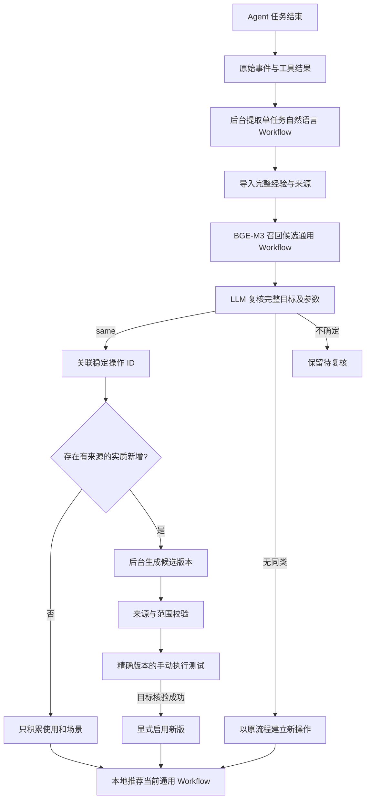

# 从 Agent 经验到通用 Workflow 和推荐

## 当前管线：二分类与统一泛化（2026-10-20）

三个在线 prompt 已统一为：

| 阶段 | Prompt | 输出与职责 |
|---|---|---|
| 提取 | `extraction/workflow_prompt.py`，`agent-awm-7` | 从真实记录提取目标、参数和自然语言步骤；来源引用单独保存 |
| 分类 | `operations/operation_admission_prompt.py`，`prototype-admission-6` | 只输出每个候选的 `same` / `different` 与简要理由 |
| 统一泛化 | `operations/operation_generalization_prompt.py`，`prototype-generalization-4` | 综合当前流程与来源，允许修改 name、goal、parameters、steps |

执行正文采用 `goal` 和字符串数组 `steps`；`name`、`parameters` 为必要管理/输入字段。
不再要求独立的 completion、check、conditions、fallbacks、task_profile；必要条件、核验与异常分支直接写进相关步骤。
模型提取输出另含 sources 和 notes；它们保存在审计记录，不进入可执行 workflow。
原始 JSON 中的自然语言字段用于 embedding 编码，`.flow.txt` 是同一内容的可读渲染。

处理顺序为：提取 → BGE-M3 Top-3 召回 → same/different → same 统一泛化。
所有候选均 different（或没有召回候选）时，以来源流程建立新组。
只有不可变版本已经被唯一组接纳时，才直接复用既有判定，省去分类和泛化请求。
其余 same 都调用统一泛化，不再通过 novelty 门槛判断“是否值得更新”。
多个候选 same 时，会联合提供所有涉及组的当前成员版本，不依据成对分类自动合并整组。

统一泛化可以重命名、重写目标、合并/拆分/删除参数、重排或精简步骤。输出只有 workflow、parameter_bindings 和 reason，
不要求模型生成逐字段 diff 或覆盖表。参数对应只描述语义关系，不生成历史参数值。
返回与当前流程完全相同的内容且仅涉及一个组时，直接关联来源，保存 no_change；无需新版本。
其它有效结果保存为 generalization 候选，当前推荐版本保持不变。
候选通过显式 `merge-reviewed` 计划审阅全部来源分支与参数迁移后启用，支持单组修订及整组合并。
workflow 为 null 时记录 unresolved 与冲突说明，不强行入组；可通过 recheck 重新分类。

`operation_update.py` 仍是兼容队列入口，但只调用统一泛化 prompt；`operation_update_prompt.py` 只是弃用的导入别名。
`operation_novelty.py`、旧覆盖校验保留给历史记录/旧候选，不参与新请求。
新入组请求约为一次分类 + 一次泛化；展示文案由既有独立后台任务生成。
输入保留 480,000 字符上限，超限报错，不截断来源；泛化按不同来源版本去重，不枚举操作子链。
这些是工程调用边界，尚未用真实模型实验验证提示词质量或总体费用改善。

旧提取、原始日志、历史 workflow 内容与 ID 不批量改写。历史 check/completion/conditions/fallbacks 仅在发送给新 prompt 时投影成文本，保留原要求。
新提取的审计 format 为 agent-workflow-v7、schema_version 为 4；可复用 `.flow.json` 的 schema_version 为 6。
旧版草稿仍可阅读、推荐和手动重新提取。修改源码后需重启源码应用/后台进程，安装版需另行打包。

## 旧管线设计与历史实验记录（2026-10-19 及以前）

下文保留旧实现和实验的说明。涉及 same/generalizable/uncertain、novelty、固定目标参数或逐字段覆盖的描述仅适用于历史版本；当前行为以上节为准。已有命令入口继续兼容。

本版改为增量入组：新经验只与候选组的**当前通用 Workflow** 比较。BGE-M3 召回，后台 LLM 判断同类与实质新增；重复经验不重写通用步骤。有新增信息时生成候选修订，保留原始来源、所有版本、模型输入输出。用户选择了“验证后启用”，因此候选不会自动替换推荐正在使用的版本。

## 入口和结果

在 Downloads 项目终端：

```sh
cd /Users/admin/Downloads/ProximicVoice-main
# 现有记录 → 单任务自然语言 Workflow，独立后台模型，开启思考
bash scripts/run-workflows.sh --latest --run
open agent-experience/workflows/library.html
# 已有提取结果 → 登记经验、迁移旧操作 ID、准备增量队列；此命令不调用模型
bash scripts/run-workflow-recommendations.sh sync
# 空闲时处理增量入组与实质更新；可能调用现有文本模型
bash scripts/run-workflow-recommendations.sh review
# 显式重试一个失败/不确定项目；超过十分钟的中断作业可恢复
bash scripts/run-workflow-recommendations.sh review --retry
# 查看通用 Workflow、候选版本、来源和每次判断
bash scripts/run-workflow-recommendations.sh report
open agent-experience/operations/index.html
# 实时本地排序预览，不调用 BGE/LLM，不操作电脑
bash scripts/run-workflow-recommendations.sh recommend --scope test \
  --context experiments/workflow_recommendations/contexts/notes.json
```

应用内：重启源码运行的应用 → Agent 的记录入口 → 操作归并与推荐。自动提取和入组仍在原有 Workflow 后台进程内运行。安装版 `.app` 本次没有重打包。所有命令可用 `--root` 指定同一个记录根目录；源码默认项目 `agent-experience`，安装版默认 AppSupport。不要把两者误认为同一个数据库。

页面现在先显示 **Workflow 组数、已入组 Workflow 条数和不同来源版本数**。点击任意组卡片进入详情，依次查看当前通用 Workflow、每条成员的完整自然语言步骤、候选和历史版本。每条成员都保留任务来源和场景；同一版本来自多次任务时分别列出，待复核记录不计入成员。归并日志和历史测试放在总览页的折叠区。直接打开 HTML 也可以完成分组浏览，不需要启动服务或调用模型。

独立回放：

```sh
# 只读固定六条测试 Workflow，输出写入新的独立目录；复核可能计费
PYTHONPATH=src .runtime/venv/bin/python \
  experiments/workflow_recommendations/prototype_replay.py \
  --output agent-experience/operation-prototype-tests/my-new-run \
  --cache agent-experience/operations/embeddings.sqlite3 --run-llm
```

这不会执行备忘录、音乐或 Safari，也不把回放次数计入正式库。`--output` 必须是未用过的新目录。测试数据仍在 `experiments/workflow_recommendations/dataset/`；不重新提取、不改写原样本。

## 执行顺序与文件职责

以下路径除说明外均相对于 `src/proximic_ring/agent_workflow/`。每一阶段的算法注释和边界条件在对应文件中，`operations/operation_catalog.py` 只编排，不堆放业务规则。

| 阶段 | 文件 / 主要入口 | 处理与输出 |
|---|---|---|
| 1. Agent 执行记录 | `agent/flow.py`、`recording/recording.py` | 异步记录公开 RPC、工具调用/结果、可获得的推理摘要；已有截图作为附件，不主动增加观察 |
| 2. 整理单任务证据 | `recording/records.py`、`recording/step_view.py`、`extraction/workflow_evidence.py::prepare_evidence` | 按 episode 组织步骤、原始事件引用和明确的观察；输出 `.input.json` |
| 3. 排队与提取调度 | `extraction/workflow_store.py`、`extraction/workflows.py::scan/process_one/serve` | 任务结束后排队，空闲时独立调用文本模型；处理配置和 busy 信号 |
| 4. 单任务提取提示词 | `extraction/workflow_prompt.py` | 提取目标、参数、具体自然语言步骤、条件与来源；不是生成公共子链 |
| 5. 模型协议 | `extraction/workflow_model.py` | 复用文本编辑服务配置，独立请求、thinking enabled；不共享 Agent 对话，不保存隐藏推理或 API Key |
| 6. 可复用结果投影 | `extraction/workflow_artifacts.py` | 从模型自然语言字段移除审计内容，保留 `.flow.json` 内部结构并渲染 `.flow.txt`，没有第二次规则概括 |
| 7. 导入经验 | **`operations/operation_ingest.py`** | 选择每个任务最新有效提取；检验 prompt 版本、来源变化、数据集 hash；区分 user/test/unknown |
| 8. 初始化与版本管理 | **`operations/operation_schema.py`、`operations/operation_prototypes.py`** | 新表迁移、稳定 ID、首版通用 Workflow、当前版本指针、成员/来源历史、候选启用规则 |
| 9. 候选召回 | **`operations/operation_retrieval.py::retrieve`** | 新 Workflow 对各组当前通用 Workflow；目标和步骤加权余弦 Top-3，返回候选及完整分数 |
| 10. 本地编码 | `operations/operation_embeddings.py`、`operations/operation_embedding_worker.py` | 现有 BGE-M3 缓存与可取消子进程；低优先级 CPU 两线程，推荐读取不加载模型 |
| 11. 入组提示词 | **`operations/operation_admission_prompt.py`** | 目标/结果/参数角色边界，same/different/uncertain，实质新增分类与原文证据格式 |
| 12. 入组执行 | **`operations/operation_admission.py::process_admission`** | 事务领取；调用召回和复核；保存判定、关联成员，或建立新组/保留不确定；无两两补查 |
| 13. 实质新增门槛 | **`operations/operation_novelty.py`** | 验证参数映射、JSON Pointer、原文引用和重复信息；有新增才排入修订队列 |
| 14. 修订提示词 | **`operations/operation_update_prompt.py`、`operations/operation_generalization_prompt.py`** | 普通增量固定目标与参数；有限泛化允许改模板，但必须保留各来源要求及参数去向 |
| 15. 修订校验 | **`operations/operation_revision_validation.py`、`operations/operation_generalization.py`** | 普通增量保留原契约；泛化检查逐字段来源、完整覆盖、参数映射与未定义参数；不能证明语义或执行成功 |
| 16. 保存候选修订 | **`operations/operation_update.py::process_update`** | 普通增量最多三个原始来源；泛化包含所有涉及的原始版本，不静默截断；绝不自动启用 |
| 17. 后台请求与作业 | **`operations/operation_model.py`、`operations/operation_jobs.py`** | 忙碌前置检查、事务领取去重、输入输出落盘、失败/中断显式重试，模型期间不持有写锁 |
| 18. 管线衔接 | `operations/operation_catalog.py`、`operations/operation_service.py` | import → prepare → admission → update；向后台传递取消信号并刷新报告 |
| 19. 推荐库投影 | **`operations/operation_library.py`** | 用当前通用 Workflow 作名称、目标和执行内容；只统计已准入的当前经验，保留原始变体 |
| 20. 本地推荐 | `recommendation/recommendation_context.py`、`recommendation/recommendation_statistics.py`、`recommendation/operation_recommendations.py` | 冻结唤起场景，按平滑场景统计排序所有通用流程；无序列、无反馈加权 |
| 20a. 主动请求与反馈 | `recommendation/recommendation_service.py`、`recommendation/recommendation_feedback.py`、`recommendation/recommendation_features.py`、`recommendation/recommendation_view.py` | 默认展示前四个，固定位置/版本；确认可见后计曝光，保存反馈及未来 LinUCB 所需特征 |
| 21. 回查和命令 | `operations/operation_view.py`、**`operations/operation_group_view.py`**、**`operations/operation_revision_view.py`**、`operations/operation_cli.py` | 总览分组数量，点击进入通用流程和逐条成员；分开展示当前/候选/历史版本，保留来源与入组结果 |
| 22. 候选执行验证桥接 | **`execution/operation_trial_bridge.py`**、原有 `execution/workflow_trials.py`/`execution/workflow_trial_cli.py` | 把精确候选版本冻结成 Trials 输入；沿用已有 Agent 执行和目标核验 |
| 共享标识 | **`operations/operation_identity.py`** | 文本归一化、内容 hash、应用提示；在线代码不再导入旧聚类模块 |
| 历史算法 | **`operations/operation_legacy.py`**、`operations/operation_matching.py` 的旧归并函数 | 仅旧算法回归/离线比较；应用和当前 CLI 不调用 complete-linkage |
| 回放实验 | **`experiments/workflow_recommendations/prototype_replay.py`** | 真实 BGE＋LLM，独立目录，记录归类效果、请求数和耗时 |
| 候选生成实测 | **`experiments/workflow_recommendations/prototype_revision_exercise.py`** | 明确标记的缺项副本与原 Notes 流程比较；真实模型生成候选，检查当前版本不变 |
| 新规则测试 | **`tests/test_operation_prototypes.py`** | 入组、重复、来源错误、范围变化、版本验证、忙碌避让、并发去重等 |



## 如何判断 same 和实质新增

Embedding 仍使用两个向量：名称＋目标＋参数说明，以及全部步骤＋条件。综合分 `s = 0.75 cos(goal) + 0.25 cos(steps)`。本版按综合分取最多三个组，要求目标分至少 0.50、综合分至少 0.55；已识别应用集合冲突时过滤。没有把相似度当作概率，也没有“超过 0.9 自动同类”。这些继承的阈值尚未通过大数据集校准。

只有**完全相同的不可变完整 Workflow 版本**已被某个唯一组接纳时，才复用其判定而不再调用模型。正常新流程必须经过 LLM；模型输入每个候选只有 operation_id、revision_id 和通用 workflow，没有塞入全组历史成员。

same 表示当前通用模板已经覆盖新任务的完整目标、最终结果和输入角色。参数必须完整映射；仅路径特有的额外输入单独列出。generalizable 表示可通过参数/条件分支组成同一明确操作模板，但当前契约还不能直接覆盖，只生成泛化候选。创建/追加/替换/删除，播放/暂停，发送/草稿，图片附件/纯文本写入等不能因为共用应用而混同。若多个候选 same 或存在不确定候选，则挂起，不靠向量排名强行选择。

实质新增需要两层判断：

1. 模型解释旧流程缺少什么、新来源补充什么，并分类为 condition/fallback/path/verification。同义改写、参数重命名、标题正文变化、重复成功不是更新理由。
2. 本地检查原文引用确实存在，quote 必须与来源字段完全一致，路径类别匹配，而且该内容未被当前通用文本直接覆盖。没有有效证据时仍可接受 same，但不生成修订。

该机制不能证明模型语义判断绝对正确。修订只保存为候选，执行验证前不会取代当前版本。新增实现必填参数时仅保留独立变体，避免悄悄改变通用操作的输入契约。fallback 即使有提取来源，也可能是提取器建议，不能声称已真实执行。

普通增量修订模型输入当前通用流程、更新理由和最多三个原始来源（种子、最近来源、新经验）。输出的名称、目标和参数必须逐字不变，变动字符串都有来源定位。局部结构校验不能验证真实桌面执行；候选可能被否决或返回 no_change/variant_only。相同修订请求去重。

### 有限泛化候选（2026-10-19）

`prototype-admission-5` 允许将附近餐饮、学校、运动设施判断为 `generalizable`：共同意图为附近场所检索，类别、筛选、排序、数量和输出字段可以参数化；地图与网页检索可保留为条件分支。评分检查只用于相关分支，学校地址核验等原要求不能省略。不能泛化成“操作浏览器”“处理信息”等没有执行意义的大类。

- `same` 仍使用旧入组路径；`generalizable` 不改变已有成员、当前通用版本或推荐使用的参数。没有独立组的新经验先以自己的原始 Workflow 建组，等待候选审阅。
- 对无歧义的相容候选，以较早建立的组作为稳定的草稿基准；若最早组已经是此次 `same` 归属，则不再创建跨组草稿。这个选择不是向量分数决策，也不执行成员迁移。
- 同一基准版本的未执行泛化请求可汇集成一次后台生成；已执行的模型输入、结果和历史候选不覆盖。输入包含所有涉及的原始来源版本；超出模型输入限制时保留失败原因，不静默截断或漏掉成员。
- 泛化候选包含完整覆盖依据，单独使用现有文本服务的 32768 输出 token 上限和 300 秒等待上限，仍开启思考。普通提取/入组/增量修订维持 16000/180；不影响前台 Agent，不自动重试已失败的候选生成。
- 候选允许修改名称、目标和参数，以及精简重复步骤。每个修改字段有 `changes` 引用；每个来源的目标、参数说明、动作、条件、核验和异常处理均有 `coverage` 指向候选中保留的位置；`parameter_bindings` 记录全部原参数的去向。
- `prototype-generalization-2` 让模型按连续步骤/条件分支提供简洁的来源对应，不要求模型计算 diff。程序展开整项步骤路径，根据明确的参数对应补齐参数说明引用，并计算 `changes`；缺失的动作/核验来源仍会拒绝。模型原始输出留在 job，展开后的覆盖表保存在候选生成依据中。
- `prototype-generalization-3` 进一步要求步骤、核验和使用条件逐处写明分支；可选条件不能写成现有入口不支持的空参数。候选的 `validation.review_notes` 可记录正文审阅发现的问题并在页面直接显示；这类问题不能由引用完整性检查证明已解决。
- 这些是可回查的本地结构检查，不是语义等价或执行成功的证明。各类别仍有条件分支；历史来源保持完整，不把覆盖表混进自然语言执行步骤。
- **自动管线只生成泛化候选**，在组详情的“候选和历史版本”查看，自然语言文件位于 `operations/definitions/<operation_id>/<revision_id>.txt`。`activate` 不接受泛化候选：实际合并须走独立的 `merge-reviewed` 路径，不能用一次普通 Trials 就替换整个模板。下方启用命令仍适用于普通增量候选。
- 新规则用于后续复核；已有组不会在升级时自动重分。手动 `recheck --sample ...` 会保留旧判断并加入后台队列。

### 经审阅的实际合并

`operations/operation_merge.py` 提供显式的 `merge-reviewed --merge-plan ...`。计划固定候选 revision、每个待合并组的当前 revision、成员/来源指纹、逐来源分支审阅和参数迁移规则；版本或成员变化、遗漏来源、后台仍在处理时拒绝提交。后台模型不能自行调用此入口，需用户明确要求实际合并。

同一事务启用修正后的候选、迁移已准入成员、把旧组 ID 设为别名并移除旧的活动头。保留所有原始 Workflow、sample/version/source、成员变更事件、旧模型候选与响应、参数历史、反馈和执行票据；新增 `operation_merges` 收据。使用统计仍按真实任务计数。旧链接显示合并去向，合并页包含原组全部历史版本。合并前已打开的旧参数契约不可重新提交或派发，须重开 Hub；原票据不会被改写成新流程。

参数直接改名时保留原观察值和证据；按已审阅规则组合的值标为 `mapped`，附原记录、原参数、拼接规则和事件引用，区别于 `observed` 的逐字实际值。不确定/缺失字段留空，不把“无”或固定类别伪造为历史输入。新记录与当前契约绑定，正常后台不会重复提取同一份映射。

此次附近场所模板保留餐饮地图、学校网页核验、运动设施地图三个条件分支；输入为 `location`、`category`、`additional_requirements`。评分/数量/学校类型按本次要求使用，无额外要求由用户填“无”。学校不执行地图与 AX 步骤，运动设施不强制评分。审阅与结构核对记录为 `reviewed_merge_not_replayed`，明确 `execution_verified=false`，不冒充三个桌面任务已重新执行。

合并计划和收据：`operations/merges/<merge_id>.json`；当前与历史自然语言版本：`operations/definitions/<原operation_id>/<revision_id>.txt`；组内每条原始步骤和来源链接保持可查。

## 版本验证和启用

1. 在操作库页面找到候选版本的完整 revision ID。
2. 写一个只含本次参数的 JSON 文件；无参数时内容为 `{}`。
3. 准备不可变快照，然后通过现有 Trials 手动运行。下面的运行会真实操作电脑，应在准备好初始界面后执行：

```sh
bash scripts/run-workflow-recommendations.sh prepare-trial \
  --revision '候选版本ID' --parameters /绝对路径/params.json \
  --initial-state '明确写出本次初始界面状态'
# 用上一条输出的 .case.json 文件路径
bash scripts/run-workflow-trials.sh run --case '/绝对路径/任务.case.json' --mode steps
# 按 CLI 提示查看实际结果，确认目标成功。仅 turn completed 不够。
bash scripts/run-workflow-recommendations.sh activate \
  --revision '候选版本ID' --run-file '/绝对路径/本次.run.json'
```

启用校验要求：自然语言 steps 模式、completed、goal_verification=success、冻结 case 指定此 revision、工作流内容和自然语言步骤一致、实际 prompt hash 一致。还检查候选 parent 是当前 active revision，防止旧候选覆盖新版。运行记录必须在同一个 root 内。激活不重新操作桌面，只移动当前版本指针，旧版本保留为 historical。

如果另一候选已经启用，旧候选不能直接覆盖它。可对对应来源重新复核增量：

```sh
bash scripts/run-workflow-recommendations.sh recheck --sample '来源样本ID'
bash scripts/run-workflow-recommendations.sh review
```

这会新增一次显式复核记录，保留之前的判定，不以完全相同版本快速通道跳过新增信息判断。

## 数据落在哪里

设记录根目录为 `R`：

| 位置 | 内容 |
|---|---|
| `R/sessions/<session>/events.jsonl`、`index.sqlite3`、`attachments/` | 原始事件、索引、工具已有附件 |
| `R/workflows/queue.sqlite3` | 单任务提取队列 |
| `R/workflows/<job>.input.json`、`.audit.json` | 任务证据、提取依据和事件引用 |
| `R/workflows/<job>.flow.json`、`.flow.txt` | 单任务内部结构和自然语言 Workflow |
| `R/operations/catalog.sqlite3` | 经验、稳定 ID、历史反馈和本版新增表 |
| `operation_heads` | 每个 operation_id 当前用于召回/推荐的 revision |
| `operation_revisions` | 内容、parent、seed/condition/path 等理由、来源、generation、验证状态 |
| `operation_memberships`、`operation_membership_events` | 当前接纳关系与不可覆盖的历次关系事件 |
| `operation_admissions` | 每次入组结果、召回分数、参数映射、实质新增判断 |
| `operation_updates` | 去重后的候选修订队列及状态 |
| `operation_jobs` | 请求领取、输入/结果、模型版本、thinking、用量、耗时、错误 |
| `R/operations/definitions/<operation>/<revision>.txt/.json` | 各通用版本的自然语言与审计导出 |
| `R/operations/*.operation-input.json`、`*.operation-result.json` | 复核/修订输入输出，不含 API Key 或隐藏推理 |
| `R/operations/embeddings.sqlite3` | 已有内容寻址向量缓存 |
| `R/operations/index.html`、`catalog.json` | 统一阅读入口及本地数据导出 |
| `R/operations/group-<operation_id>.html` | 单组详情：当前通用 Workflow、全部已准入成员、候选与历史版本 |
| `R/workflow-tests/<case>.case.json`、`<run>.run.json` | 未来手动验证候选版本的执行快照与核验记录 |
| `R/operation-prototype-tests/<run>/` | 本次独立回放数据，不进入正式用户使用次数 |

旧 pairs、review_jobs、assignments、review-input/result 不删除。迁移以旧组最早的当前完整流程作种子，保持组 ID，然后重新检查其他成员是否符合该通用流程；旧逐对结论只是历史证据，不冒充对新通用版本的判断。未完成新准入的成员会在队列中显示，暂不计入新推荐频次；旧数据仍在原表可查。

推荐现已替换为下面的场景统计方案。旧的频率、应用提示、反馈加权总分不再使用；候选版本仍不会混入推荐内容。用户与测试统计分开，已导入的测试操作仍可作为冷启动候选，但测试次数不计入真实使用频次。

## 主动请求推荐：默认前四个

源码应用现已接通原生执行入口：默认连续两次食指捏合（`double-index-pinch`）唤起推荐，也可点击 Agent 卡片「推荐」或「手势」页的「查看推荐」。先排序全部通用 Workflow，再显示默认前四个（不足四个则全部返回）。每次请求固定位置 1–4、操作 ID、通用版本、分数与参数要求；打开期间不会随后台更新重新排序。无参数的操作点击即送给现有 Agent；有参数的操作先填写，再点击发送。四方向 swipe 选择尚未绑定。没有 just-in-time 提示或自动弹窗。

HTML 总览仍是统计回查和反馈入口；实际执行请使用上述原生推荐面板。打开 HTML 交互页：

```sh
bash scripts/run-workflow-recommendations.sh serve
# 打开终端输出的网址，在「主动请求推荐」面板点击获取
```

直接打开 HTML 可以查看组数、各组静态分数和计算依据，但不能提交曝光或反馈。静态分数使用未知场景，明确回退总体频率；它不代表导出时读取了当前桌面。独立 `serve` 没有应用内的唤起回调，也会标记场景缺失；模拟 Safari/Music/Notes 只用于测试范围。原生面板和应用内记录服务都在本次请求时重新捕获前台应用元数据与时间。原生入口先捕获、再排序、最后显示窗口，避免读取到推荐窗口自己；捕获失败不拿上次 Agent 场景替代。独立 `serve` 仍没有应用内捕获回调。

### 排序公式与缺失处理

每次真实任务只贡献一份使用质量；同一任务产生多个组时均分，多次提取不增计次。未来时间、无效时间和来源不明的样本不参与。每条记录按 30 天半衰期衰减：

```text
w = 2 ^ (-距任务发生的天数 / 30)
P0(g) = (组 g 的使用质量 + 0.5) / (所有组的使用质量 + 0.5 × 组数)
P下一层(g) = (本层匹配组 g 的质量 + 3 × P上一层(g)) / (本层全部匹配质量 + 3)
```

从总体频率开始，按当前已知的维度依次增加「同应用」「同四小时时段」「同周内/周末」条件；每层是目前累计条件的交集。缺失维度跳过，没有匹配记录时退回上层。周末只指星期六/日，不推断法定假期。窗口标题保留于来源但不计分。没有序列特征、目标应用加分、语义召回或接受率加权。这些参数是可解释的初始设定，未经过准确率校准；分数是归一化统计估计，不能当作已校准的用户意图概率。完全没有使用证据时各组均分，以稳定 ID 打破并列。

### 每一步由哪个文件完成

| 顺序 | 文件与入口 | 责任 |
|---|---|---|
| 1 | `ui/agent/agent_controller.py::_capture_invocation` | 在原有焦点捕获流程冻结应用、时间、触发来源；异步提交记录，不新增截图或阻塞 Agent 派发 |
| 2 | `recommendation/recommendation_context.py` | 创建 invocation ID，规范化应用/时段/周内周末；历史以唤起时间判定新鲜度，实时查询拒绝过期上下文 |
| 3 | `recommendation/recommendation_statistics.py::score_groups` | 对同任务去重、时间衰减、逐层平滑；生成每层计数、先验和回退依据 |
| 4 | `recommendation/operation_recommendations.py::recommend` | 遍历全部当前通用 Workflow，排序并给每项稳定位置、版本、缺失参数和分数依据 |
| 5 | `recommendation/recommendation_features.py::feature_snapshot` | 保存带 schema 的场景及候选特征，留作后续 LinUCB 输入；本版不训练或更新矩阵 |
| 6 | `recommendation/recommendation_service.py::request_recommendations` | 网页/原生手势共用入口，默认 limit=4；保存不可变请求快照，单纯调用不会算曝光 |
| 7 | `recommendation/recommendation_view.py`、`recording/records_server.py` | 展示 Top-K；摘要至少一半可见、页面有焦点并持续 500ms 后确认曝光，随后启用反馈按钮 |
| 8 | `recommendation/recommendation_feedback.py` | 校验请求候选和来源，保存幂等曝光与显式反馈；输出带当时特征的训练样本 |
| 9 | `recommendation/recommendation_service.py::selection` | HTML 回查返回冻结的位置、操作/版本、步骤和缺失参数 |
| 10 | `ui/agent/recommendation_controller.py`、`recommendation_dialog.py` | 原生唤起前捕获场景，异步请求、可见曝光，填写参数并点击执行 |
| 11 | `execution/recommendation_execution.py` | 校验参数、单次占位符替换，保存幂等执行票据，避免重复点击重复派发 |
| 12 | `execution/recommendation_agent.py`、`agent/flow.py` | 将冻结的自然语言目标和步骤交给现有 Computer Use Agent，沿用审批、取消、电脑控制释放与完整记录 |
| 13 | `recommendation/recommendation_catalog.py` | 内容 token 检测已准入成员/当前通用版本变化；面板提示更新，不自动换项 |

网页可见确认是客户端报告，服务端无法证明用户已经阅读。未点击不当作拒绝；「暂不判断」不产生正负标签。每次曝光的偏好、执行结果分别最多一条，重复同值幂等，冲突需重新请求。原生面板在最终点击执行且参数完整时保存接受反馈；关闭参数页不算接受。选择代表接受推荐，不代表任务执行成功。评分完全不读取反馈来学习权重。

接口（路径前面仍需记录服务的随机访问前缀）：

- `POST api/operations/recommend`：`{scope:"user",limit:4,trigger:"manual"}`；返回 request_id、全部候选摘要和前四项。原生手势调用同一个 Python service，trigger="gesture"、surface="native"，传入本次触发时的场景；网页不接受伪造的真实场景。
- `POST api/operations/exposure`：`{request_id,operation_id}`，只允许本次实际返回的 Top-K；返回 exposure_id。
- `POST api/operations/feedback`：`{exposure_id,operation_id,kind:"accepted"}`；accepted 返回冻结的 selection；rejected/ignored 只记录反馈。
- `training_examples(store, scope="user")`：导出 accepted/rejected 的 1/0 奖励、展示时特征、全部候选 ID、位置和版本。确定性排序的动作概率记为 null，不伪造可用于离线策略评估的 propensity。

数据仍在 `R/operations/catalog.sqlite3`，推荐相关表：

| 表 | 内容 |
|---|---|
| `recommendation_invocations` | 唤起 ID、时间、原始场景及可获得状态 |
| `recommendation_requests` | 本次策略/schema、完整候选与前四项快照、场景、来源、分数/依据 |
| `recommendation_exposures` | 已确认可见的候选、位置、通用版本、确认方式与时间 |
| `recommendation_feedback` | 按曝光关联的接受/拒绝/未知，以及单独的执行结果 |
| `recommendation_executions` | 一次曝光对应最多一张执行票据；冻结参数、自然语言提示词、目标、场景、来源版本和执行任务关联 |

旧 `impressions` 和 `feedback` 原样保留，不追认成符合新标准的真实曝光。将来 LinUCB 可以消费新数据，但这一版不会因接受/拒绝改变统计分数。

## 不阻塞 Agent 的具体约束

UI 只传配置和 busy 标志到原有后台进程。先完成单任务提取队列，再逐项入组/修订；每次新模型调用前再次检查 busy/stop。BGE-M3 在独立低优先级进程里，两线程，前台开始工作后终止并缓存已完成部分。模型推理和网络请求期间不持有操作库写锁。

已发出的云端请求在后台收完并保存，避免丢弃结果导致重复计费；后续请求等待空闲。HTTP 失败、结构错误、来源变化、崩溃不自动重发付费请求。并发 CLI/后台由事务领取保证同一库只有一个正在处理的作业。不能把进程隔离理解为远端服务或系统资源绝对零竞争；本次没有做 Agent 对话延迟 A/B 测试。

## 参考与适配边界

- [Summaries as Centroids](https://arxiv.org/abs/2502.09667)：参考组的文字原型及其向量；本项目还需要参数化执行、来源、候选验证，不直接照搬 k-means 的强制归属。
- [LLooM](https://github.com/michelle123lam/lloom)：参考自然语言概念和明确归属标准；本项目用通用 Workflow 的目标、参数和结果约束操作范围。
- [LLM-Guided Lifecycle-Aware Clustering](https://aclanthology.org/2025.ijcnlp-long.170/)：参考候选组召回后由模型确认归属的增量结构。
- 本实现不保证严格组内两两语义等价；用稳定通用流程、保守不确定状态和候选验证换取有界常规复核成本。没有伪称仍满足 complete-linkage 条件。

## 2026-10-16 实测结果

- 固定六条现有 Workflow 原样回放：3 个操作、每组 2 条，三对预期同类均入组，没有额外误合并。共 3 次真实模型复核，模型耗时合计 76.944 秒，总流程 77.003 秒（使用现有向量缓存）。这批差异都被判断已覆盖，未生成修订版本。小样本结果不能证明大规模准确率。
- 额外受控缺项测试：明确标记的 Notes 副本移除 fallback，再以原始完整 Notes Workflow 作为新证据。真实模型复核＋修订共 2 次，约 29.58 秒，生成 1 个 fallback 候选版本；原 active 版本保持不变，保留“恢复方法未实际执行”的来源说明。这是机制测试，不是新增用户操作或推荐准确率样本。
- Downloads 同步后完整相关回归：214 项通过，34.85 秒；覆盖记录、Agent UI、现有 Trials、历史算法对照，以及本版 28 项准入/版本/忙碌保护测试。独立测试页面的无效导航已修正；三份报告的本地文件链接均已通过校验。
- 测试入口：`agent-experience/operation-prototype-tests/20261016-first/index.html`；候选例子：`agent-experience/operation-prototype-tests/20261016-revision-exercise/operations/index.html`。两者使用独立数据库，不写正式使用频次。
- 同步前备份：`.runtime/backups/workflow-prototypes-20261016-160016/`；其中 `catalog-before.sqlite3` 为一致快照，`synced-files.json` 列出精确同步文件和哈希。

正式 Downloads 库迁移结果：4 个通用操作、7 条已有经验，样本 ID/版本 ID/操作 ID 全部保持一致。42 条历史 pairs、2 个历史 review_jobs、1 条 impression 和1条 feedback 数量与内容保留；新表新增3次入组复核，全部接受原有归属。文字笔记对图片附件操作的候选被判断为 different。本次未生成正式库候选修订。

## 2026-10-16 场景统计与主动请求验证

- 工作区与 Downloads 分别通过 282 项相关测试，包括默认前四项、请求与曝光区分、页面前台可见 500ms、固定位置和流程内容、反馈幂等及不影响分数、时区比较、测试隔离，以及 Agent UI/记录/Workflow/Trials 回归。页面交互逻辑用合成 DOM 验证，本次没有通过浏览器实测真实页面。
- 正式库仍有 4 个组、7 条经验（1 条真实、6 条测试），旧记录表内容保持不变；新增真实曝光和反馈均为零，没有为验证伪造用户反馈。三份报告共 183 个本地文件链接均存在。
- 已同步 21 个实现、测试和文档文件，保留 Downloads 原有的无关手势差异。备份在 `.runtime/backups/scene-recommendations-20261016-170723/`；数据库快照包含新增的四张空推荐表，详情见目录中的说明。
- 本次仅刷新独立查看服务；源码运行的主应用需下次重启才能加载新场景记录代码，安装版未重新打包。

## 原生手势到 Agent 的完整链路（2026-10-16）

### 使用入口

在 Downloads 项目启动源码应用（安装版无需替换）：

```sh
cd /Users/admin/Downloads/ProximicVoice-main
PYTHONPATH=src .runtime/venv/bin/python -m proximic_ring.ui
```

1. 正常让 Agent 完成任务，保持自动提取开启；沿用现有文本模型配置和 thinking enabled。
2. 后台提取完成、入组成功后，该任务才参与通用操作的使用统计。
3. 连续两次食指捏合唤起推荐，或用 Agent 的「推荐」按钮。
4. 点击操作；笔记等参数化流程先填写标题、正文，再发送。不会预填历史私人内容。
5. 任务继续在原有 Agent 窗口显示进度、询问和取消入口。新任务以 `workflow_recommendation` 来源记录，完成后再次走后台提取/入组。

手势配置：手势页 → 全局默认 → 双食指捏合 → Workflow 推荐。可改绑其他支持的手势或取消绑定；应用专属映射仍优先，输入框内已绑定的语音手势及 Agent 上下滑仍优先。双中指切换 Agent 的原有功能保持不变。

`firmware_gestures.py` 新增食指双捏合成，采用 SDK 120–600ms 配对区间。为了避免先触发单捏菜单，单食指事件需等待最长约650ms；配对成功只发一次双捏，断连丢弃未完成配对。`gesture_settings.py` 保存全局映射，`ring_gesture_controller.py` 按现有优先级路由到原生面板。

### 更新时机

| 事件 | 行为 |
|---|---|
| Agent 开始任务/文本编辑忙碌 | 立即向后台发送 busy；不等待三秒心跳才标记。新模型任务等待空闲，已开始的云端请求独立收尾 |
| Agent 任务结束 | 原始记录异步落盘；扫描约每4秒一次，结束记录至少稳定3秒后自动入队 |
| 提取完成 | 当前队列继续处理；队列空闲后同步操作库，BGE-M3 召回、LLM 复核，成功入组才更新使用样本 |
| 同类重复经验 | 新增一次独立任务使用；重复提取同一任务不增计次；无实质新增不重写通用步骤 |
| 通用流程候选修订 | 保持当前可用版；候选经明确验证启用后才改变推荐使用的流程 |
| 用户唤起/手动刷新 | 在工作线程重新捕获当时前台应用/时间，读当前操作库，重新统计和排序，返回前四项 |
| 面板已经打开 | 每2秒检查内容 token 与后台状态；库变更只显示刷新提示，步骤、位置及填写中的参数保持不变 |
| 用户接受/拒绝 | 保存曝光、反馈和当时特征，当前算法不立即改变分数 |
| 用户执行推荐 | 新建幂等票据，送入现有 Agent；真实使用需等本次任务提取并入组后才计次，不在点击时重复计数 |

后台同步的空闲周期约10秒，但提取完成/入组完成会将同步计时清零；模型耗时和忙碌等待另外计算。因此不是任务结束后立即出现一个新推荐。失败不自动重复付费，报告保留错误并沿用原有手动重试入口。原生面板会显示提取队列、待入组数量及失败数量。

每次曝光最多派发一次执行，重复点击不会重复操作。执行时 Agent 已忙则拒绝，不把推荐当 steer 或偷偷排入其他任务；需要重新请求。连接中断不自动重发。`completed` 仅指收到 Agent 本轮完成事件，`unfinished/not_started` 保留未完成原因，不自动记录成功反馈或启用候选版本。

### 完整实测

可显式复现（会真实播放音乐并调用后台文本模型）：

```sh
PYTHONPATH=src .runtime/venv/bin/python \
  experiments/workflow_recommendations/live_app_smoke.py \
  --output agent-experience/recommendation-tests/my-new-run
```

输出目录必须尚不存在。该脚本运行真实 AppController、AgentOverlay、Flow、后台提取进程、BGE-M3 和 LLM 入组，以及原生推荐面板；所有样本与反馈为 test，写入独立数据根目录，不污染正式用户习惯。手势通过真实 FirmwareGestureWorker 注入两帧测试数据，不建立第二条蓝牙连接；实体戒指的 BLE 链路需要现场确认。

此次 `20261016-live-1` 完整通过：普通音乐任务 → 自动提取并建立1个组 → 双食指事件 → 捕获请求时的 Codex 前台场景 → 原生曝光和点击 → Agent 再次播放 → 自动提取和同组接纳 → 重新请求时统计为2次测试任务。总耗时274.826秒，包括真实 Agent 与后台模型调用；这不是提速 A/B 评测。第一次遇到 Apple 账户登录，由用户在 Agent 询问中选择改播本地音频，之后没有登录或填写账户信息。

结果见测试目录的 `result.json`；原生面板截图为 `recommendations.png`；完整会话、Workflow、归并及票据在其 `agent-experience/` 子目录。只有一个组时分数为1，验证的是链路与计次，不能据此评价推荐准确率。

最终 Downloads 验收：441 项相关回归通过（123.30秒），涵盖原生参数执行、真实曝光边界、重复派发保护、当前应用重新采集、任务忙碌、现有 Agent/Trials、手势优先级和界面加载。25 个文件已同步；保留 Downloads 独有的应用映射及输入行为。同步前文件及一致性数据库备份位于 `.runtime/backups/native-recommendations-20261016-174419/`。正式数据库原有全部表逐行校验不变；新增执行表为空，实测数据留在独立测试目录。分组报告的53个本地链接全部有效。源码应用需重启后载入新模块。

### 推荐 Hub 样式与输入（2026-10-19）

原生 Hub 按提供的 `recommend-hub/hub.html` 改为浅色玻璃圆盘：三层圆环、四个方向节点、方向色晕、悬停联动、沿选中方向展开的参数卡。中心「你想」与选中操作名放大为主要信息。节点内容来自当次冻结的真实推荐，示例中的订餐厅、发消息等不会自动加入操作库。中心仅显示实际捕获的应用，不推断「正在阅读文章」等未观测活动。

- `double-index-pinch`（连续两次食指捏合）默认唤起；沿用全局手势设置及现有输入优先级。在鼠标所在屏幕中央置顶显示，屏幕不足时等比缩小。原生输入法候选窗仍可显示在 Hub 上方。Hub 与主界面、Agent 浮窗独立管理焦点。
- 鼠标悬停圆形节点或操作标签会高亮该方向并更新中心操作名。点击节点或文字展开参数；也可用上、右、下、左手势选择。未选方向变淡，位置和版本不变。
- 上下方向参数横排，左右方向竖排；参数多时在卡片内滚动。每个输入框都是原生 IME 客户端，沿用现有语音和笔画手势。鼠标切换输入框后输入归当前字段；不会复制历史私人内容。长文本支持 Shift+Enter 换行及框内滚动。
- 点击「完成」、Enter 或上滑提交。点击完成时若仍在听写，会沿用上滑的结束听写→等待定稿→提交路径；未确认的输入法预编辑或笔画候选不能提交。执行前校验全部参数，零参数流程也需确认；后台提交期间禁用按钮，避免重复派发。
- 点击「取消」、选中节点、圆盘内部或 Esc 收起参数；本次打开期间保留已输入草稿。点击图样与参数卡外部、切换到其他窗口，整个 Hub 用 500ms 淡出；开始淡出即释放输入并使旧请求失效。Hub 状态下 Esc 或中心圆底部的小 × 同样淡出关闭。圆内小 ↻ 刷新重新采集场景并排序，参数展开时禁用刷新。

实现：`agent_workflow/ui/recommendation_wheel.py` 负责绘制和鼠标目标；`recommendation_dialog.py` 负责原生参数卡及独立浮窗；`recommendation_input.py` 复用语音/笔画提交；推荐和执行仍使用原来的控制器、快照及幂等票据。

回归入口（使用临时数据库，派发边界被替换，不真实操作备忘录/音乐）：

```sh
PYTHONPATH=src QT_QPA_PLATFORM=offscreen QT_QUICK_CONTROLS_STYLE=Basic \
  .runtime/venv/bin/python -m pytest \
  tests/test_recommendation_hub.py tests/test_recommendation_ui.py \
  tests/test_recommendation_gestures.py tests/test_recommendation_execution.py
```

设置 `MYTHLINK_SCREENSHOT_DIR=/tmp/mythlink-hub-shots` 可保存四方向及多参数界面截图。UI 回归覆盖模拟 IME 提交、语音定稿、笔画候选、鼠标按钮和手势路由；实际戒指无线传输和云端识别需连接设备使用验证。


### 无底板悬浮样式与中心文字边界（2026-10-19）

Hub 仅显示圆盘、节点、文字和当前展开的参数卡；画布透明，无外围矩形底板、系统窗口阴影、角落工具栏或常驻底部说明。关闭和刷新收进中心圆底部。窗口形状按可见元素与必要阴影生成，外围空白不属于鼠标交互区域；方向标签的交互范围也按实际文字宽度收紧。参数卡收起后同步移除对应区域。错误和库更新仅在有信息时显示临时提示。

中心圆保留 10 像素安全边界，应用图标、应用名、「你想」、操作名及底部小按钮分区排布。操作名采用 Qt 字形测量和词/字符边界换行，字号在 27–21 之间选择，最多两行并平衡行宽。超过容量时仅省略显示文字，完整名称仍可通过悬停查看，实际 Workflow 内容保持完整。最终圆形裁切防止特殊字体或字符越过圆圈。应用名同样按可用宽度省略。

新增回归覆盖透明 PNG 的外围 alpha、鼠标形状区域、参数卡收起、中文/英文长词/emoji/换行的文字边界；保留各方向参数、语音定稿和笔画候选测试。

### 展开动画、独立焦点与外部点击（2026-10-19）

每次从隐藏状态唤起时，四个节点在 420ms 内从中心向四个方向展开，标签随后渐显。节点从中心圆后方露出，不覆盖中心文字；遵循 macOS「减少动态效果」。展开过程中的首次点击或滑动会保留为待选择方向，实际显示完成且满足原有 500ms 曝光条件后打开参数卡，不自动执行任务。

`recommendation_focus.py` 单独管理 Hub 的原生焦点和外部点击。macOS 以该 NSPanel 是否为 key window 判断焦点，显式唤起时只激活这个面板；编辑字段、点击完成/取消不会重新激活整个应用。参数卡与输入框属于同一 Hub；原生语音/笔画输入源助手、关联菜单与输入法候选窗不会被当作外部点击。外部点击不被拦截；淡出期间 Hub 停止接收鼠标和手势，旧异步请求不能继续提交，重新唤起会创建新请求。

真实 macOS 窗口回归（临时数据库、模拟推荐、临时外部窗口，无真实 Agent 任务）：

```sh
PROXIMIC_TEST_HUB_NATIVE=1 PYTHONPATH=src QT_QPA_PLATFORM=cocoa QT_QUICK_CONTROLS_STYLE=Basic \
  .runtime/venv/bin/python -m pytest tests/test_recommendation_hub_native.py -q -o addopts=''
```

该回归验证主界面后台可见、最小化、隐藏三种状态下，打开 Hub 与输入参数不改变主界面状态和前后层级；验证四方向手势路由、AppKit 鼠标点击、真实键盘输入以及实际点击外部后的淡出。戒指蓝牙事件和真实语音识别仍需设备现场验证。

## 多类型任务的归并和推荐

`agent-awm-6` 的单任务自然语言 Workflow 可以只有一步，包含可多选的 `task_profile.task_types` 和 `output_kinds`。问答、写作、计算、代码、文件与应用任务沿用同一操作 ID、参数、来源、版本和推荐链路，不需要另建公共链。

1. 导入保留完整自然语言步骤及语义分类；来源中另存实际执行工具事实 `execution_profile` 和任务整体分类，便于回查。同一任务重新提取仍是同一条经验，不增加使用频次。
2. BGE 的目标文本额外包含新流程的分类/输出名称，仍主要比较完整目标与步骤；没有分类的历史向量文本保持原样。分类不做自动合并或硬性类别过滤。
3. 新版通用任务不因方法文本中出现不同应用名而在召回前硬拒绝。后台复核核对用户是否指定目标应用、交付位置、输入角色、输出约束或不同副作用；界面、命令、API 可以只是不同实现方式。
4. 单步回答与多步工具操作同样经过语义复核。解释单个概念与比较多个概念不能仅因“问答”标签而合并；复用方法、重新生成本次答案，不保存固定答案模板。
5. 普通增量候选须保留已有目标、参数与 task_profile；有限泛化候选可调整目标/参数模板，但需完整来源覆盖；自动管线不启用，实际合并另行审阅与明确授权。实际来源工具不会自动升级为所有执行的硬前提。旧版提取、分组及候选仍可回查，已有通用版本不会因升级而自动改写。
6. 实时推荐算法和特征不变，仍读取场景统计；本次把通用任务接入候选库，不宣称分类标签本身就能预测用户意图。测试来源（含 calculation/固定回复验证）不计入真实习惯。

## 参数规则优先与可选输入（2026-10-20）

参数后台现在使用 `parameter-history-2`：先复用当前契约下来源仍一致的已核对值，再处理明确参数字段、无冲突的唯一输入文件路径、用户明确指定的数量；有冲突、更正或证据不完整时交给 LLM。规则已处理的参数不再进入模型的待判断列表。模型只收到目标、参数定义和来源片段，不再重复发送完整步骤。全部参数能由规则确定时不会请求模型；同版本的完成 Hub 票据继续直接提供历史值。

`parameter_evidence.validate` 允许 missing/uncertain 省略空 `value`、空 `evidence` 和简短说明，由本地补齐；observed 仍须有可回查原文。数量的中文/全角/阿拉伯整数由规则归一化，保留 `normalization.raw_value`、规则名和原始引用；不拼接地址或补造路径。未知参数、重复参数、错误引用和没有依据的值仍不入库。规则与模型路径记录在 generation 中，实际 API usage 仍来自服务端。

新参数可以声明 `required:false`，表示启动前允许留空；未声明时默认必填。提取 prompt 为 `agent-awm-8`，泛化为 `prototype-generalization-5`，均说明可选/可推导输入的缺省处理。旧流程不重写：`parameter_contract.required` 只兼容描述中明确的“可选”“可不填”或“未指定时…”；明确必填优先，`required` 布尔字段最优先。

推荐的 missing_parameters 只列必填缺失项，optional_parameters 单列可选项。原生表单标注可选、默认留空，并提供可切回留空的候选；该空选项不计为历史使用。前台校验、执行票据及 Trials 共用参数契约。未指定值在票据中保持空字符串；派发给 Agent 时使用缺省标记并附带该参数原有说明，让 Agent 按流程处理或必要时询问，避免把空值当作搜索词或文件名。必填缺失、额外参数和重复派发仍被阻止。

复测采用同一批原始任务和上一轮冻结的通用流程，重跑参数提取、推荐、测试副本中的命令组装；不重新随机提取/合并，也不在桌面重做任务。报告见 `experiments/workflow_recommendations/runs/20261020-parameters-v2/index.html`。这次四条有效任务均首次通过；调用量由含重试的 6 次降为 4 次，token 由 41,512 降至 20,908，API 累计耗时由 201.549 秒降至 89.593 秒。模型和思考模式保持原配置；单批结果不代表稳定准确率或稳定加速比例。
